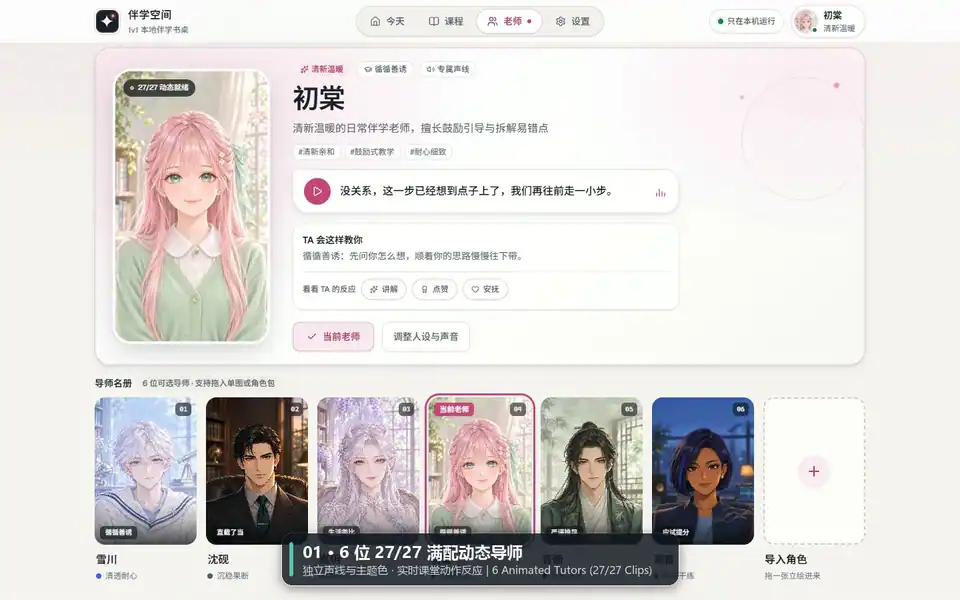
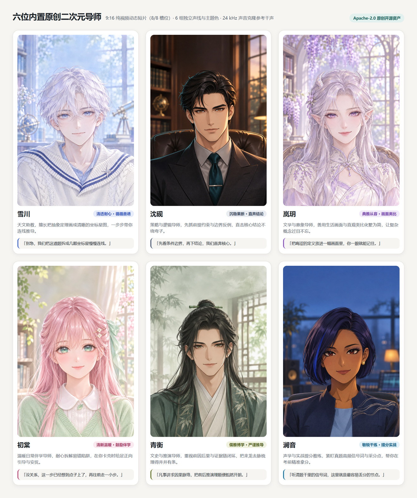
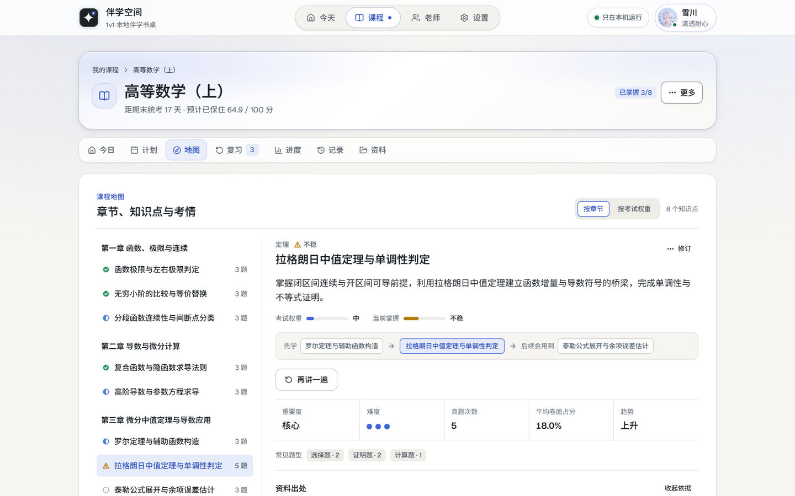
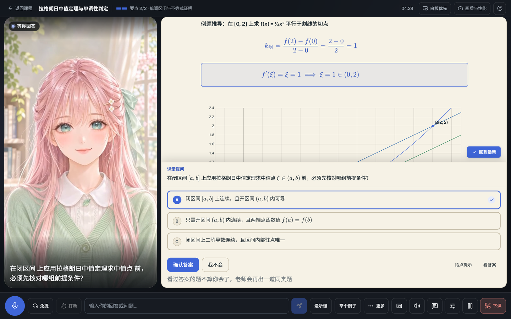
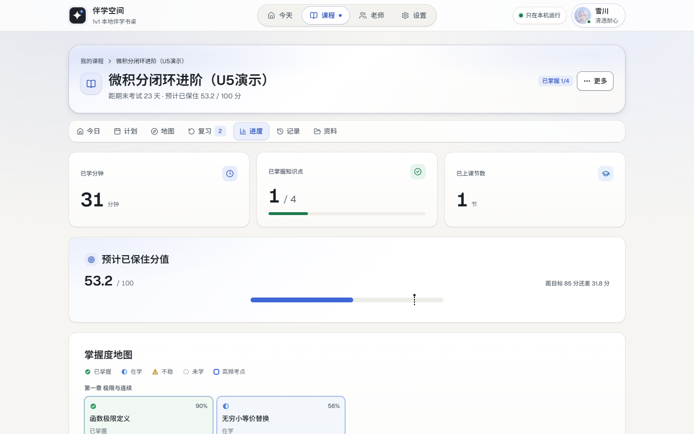
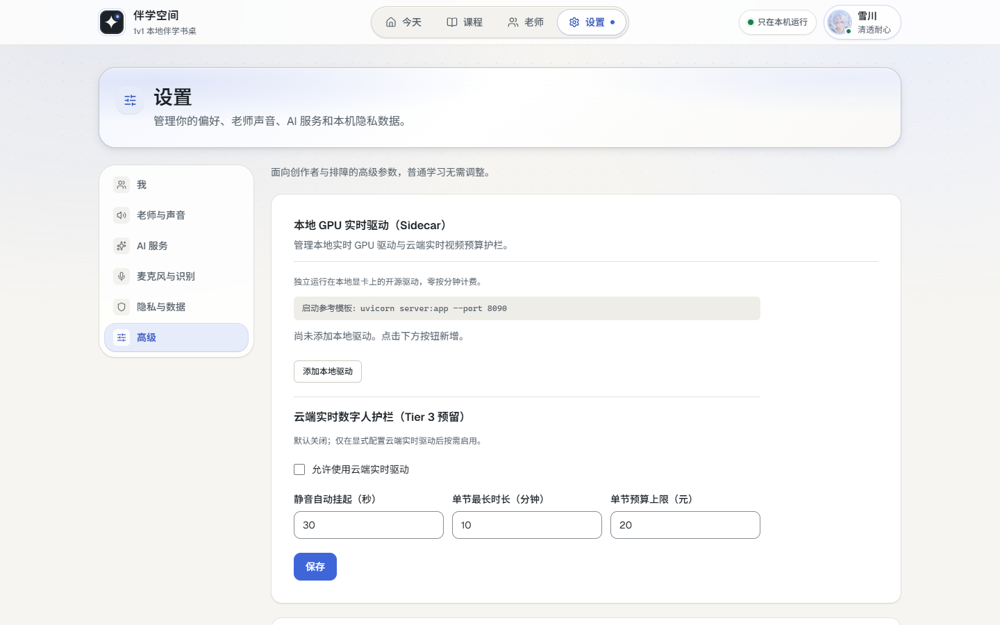
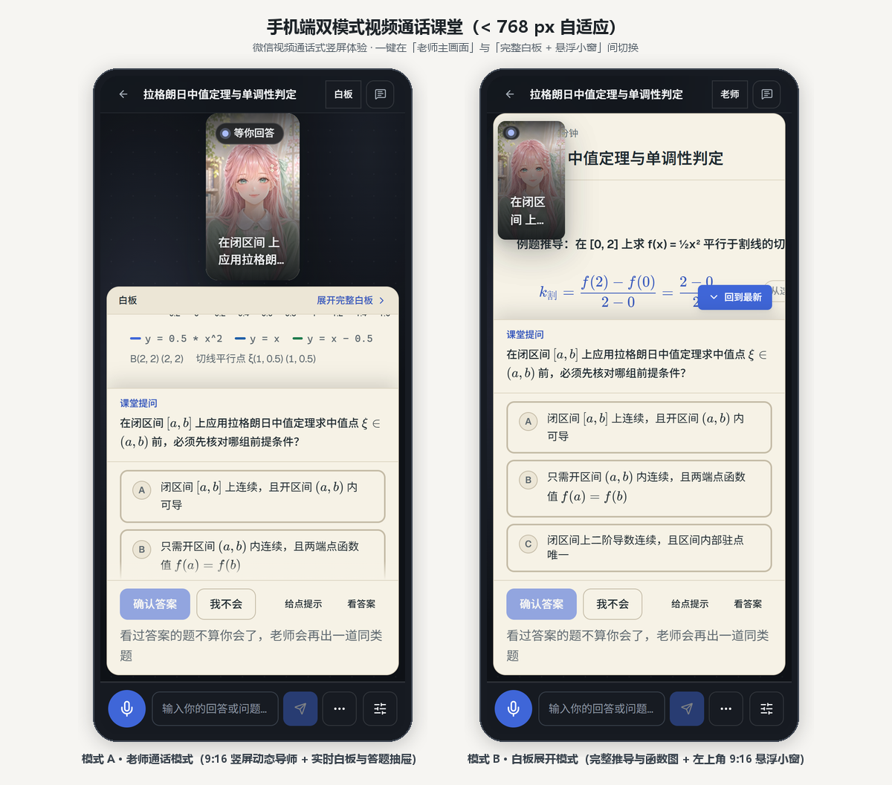
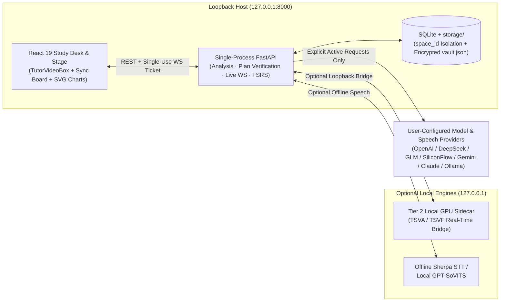

<div align="center">

# Companion Space

**A local-first, video-call style anime AI 1-on-1 tutor**

Drop in your textbooks, slides, notes, and past exams — get a **source-linked course map, a 9:16 pure-video animated anime tutor, a synchronized blackboard, and FSRS spaced review** right on your own computer.

[简体中文](README.md) · [English](README.en.md) · [Quick Start](#quick-start) · [Changelog](CHANGELOG.md) · [Privacy & Data](docs/privacy-and-data.md) · [Asset Licenses](assets/avatars/LICENSES.md) · [Contributing](CONTRIBUTING.md)

[](https://github.com/Johnson-Durui/Companion-Space/actions/workflows/ci.yml)
[](https://github.com/Johnson-Durui/Companion-Space/releases)
[](LICENSE)
[](#privacy-security--guardrails)
[](#three-tier-pure-video-avatar-architecture)

</div>

<p align="center">
   Source-linked Course Map -> Lesson Lobby warmup -> Live 9:16 anime tutor + KaTeX derivations & SVG function plots -> 150ms instant praise reaction -> Mastery & FSRS review" width="960" />
</p>
<p align="center">
  <sub>Try the interactive <b>Sample Lesson</b> in 30 seconds with zero API keys, or connect your preferred model provider to study from your own materials.</sub>
</p>

---

## From Raw Materials to Mastery in Four Steps

Most AI study apps are just scrolling chat windows, while browser-based 3D VRM renderers burn laptop GPUs and still look stiff. **Companion Space** pairs a calm daytime **Study Desk** with an obsidian **1-on-1 Video-Call Classroom**:

| Stage | What You Do | What Companion Space Does |
| :--- | :--- | :--- |
| **1. Grounded Course Setup** | Drop in PDFs, PPTX, DOCX, images, or Markdown (textbooks + past exams) | A 5-step setup wizard extracts chapters & concepts with **exact page citations**, computes exam frequency & score weights, runs a quick 6-topic learner interview + placement check, and builds an **explainable study plan**. |
| **2. Warmup & Video Connect** | Click **Start Lesson** from Today (optionally flip through ≤ 5 due warmup flashcards) | Enters a zero-scroll classroom stage (`<StageShell>`) with a vertical **9:16 pure-video tutor** (`<TutorVideoBox>`) using 180 ms dual-`<video>` crossfades and zero WebGL GPU overhead. |
| **3. Live Synchronized Blackboard** | Listen, interrupt anytime via push-to-talk / hands-free VAD, or click any derivation line | KaTeX formulas, progressive line-by-line steps, 3-style emphasis marks, SVG function plots with legends & point labels, and Mermaid diagrams appear in sync with speech — complete with *"lost from this line"* re-explanation, board pagination, and an in-memory transcript drawer (`Shift+T`). |
| **4. Spaced Retention Loop** | Complete inline checks, daily review sessions, and timed practice runs | Triggers **150 ms micro-reactions** (praise / comfort) on grading, summarizes pre→post mastery gains on recap, schedules **FSRS review cards** & mistake drills, and tracks your **projected score** across an accessible mastery grid. |

---

## Why It's Not Another Chat Wrapper

- **Anti-Hallucination Teaching Engine**:
  - **Independent Pre-Class Verification**: Extracted exam answers and generated check questions must pass independent verification before entering the gradable item bank.
  - **No Unverified Improvised Questions**: Live lessons draw checks strictly from verified lesson plans. Objective items (single-choice, multi-choice, numeric) are graded deterministically in backend code; open responses follow explicit rubrics.
  - **Evidence-Only Mastery**: Mastery updates strictly from genuine answer evidence — peeking at answers or exhausting multi-level hints never inflates mastery and schedules a variant follow-up instead. Enforced in CI via `scripts/check_no_fakes.py`.
- **Zero-Scroll Desktop + Dual-Mode Mobile Video Call**:
  - Desktop live phases fit inside a zero-scroll viewport (`1280×585` up to wide 3-column layouts) with **Split / Board-First (draggable 9:16 PiP)** switching and full keyboard shortcuts (`?`).
  - Mobile (`< 768 px`) switches seamlessly between a WeChat-call style **Tutor Mode** and a full **Board Mode** with a floating 9:16 tutor window.
- **100% Local-First Ownership**:
  - Single-process loopback server (`127.0.0.1:8000`) backed by local SQLite, local file storage, and an encrypted server-side credential vault (`vault.json`). Raw microphone PCM16 audio and live classroom transcripts **stay strictly in memory and never touch disk or logs**.

---

## Six Built-In Anime Tutors (Apache-2.0, Animated Out of the Box)

All six built-in tutors are original **Apache-2.0** creations bundled directly in the repository. Every tutor ships with:
- **A dedicated WCAG-verified accent palette & distinct neural Chinese voice**;
- **Complete 8/8 silent VP9 motion loop packs** (`idle_breathe`, `listen_nod`, `think_chin`, `speak_explain_a/b`, `board_point`, `react_praise`, `react_comfort` — 48 `.webm` clips total);
- **Normalized 24 kHz studio-dry voice-clone reference WAVs** ([`assets/avatars/voices/`](assets/avatars/voices/voices_manifest.json)) ready for local GPT-SoVITS / CosyVoice / FishSpeech pipelines.

<p align="center">
  
</p>

| Tutor | Persona & Specialty | Default Style | Signature Line | Bundled Open Assets |
| :--- | :--- | :--- | :--- | :--- |
| **雪川 (Xuechuan)** | Clear, patient astronomy TA who maps abstract concepts like star charts | Guided | *"Take your time — let's split this problem into a few anchor stars and connect them."* | 8/8 VP9 clips + 24 kHz ref WAV |
| **沈砚 (Shenyan)** | Decisive logic & strategy mentor focused on constraints and core conclusions | Direct | *"Check the boundary conditions first, then draw the conclusion straight to the core."* | 8/8 VP9 clips + 24 kHz ref WAV |
| **岚玥 (Lanyue)** | Graceful literature & imagery tutor who turns dense definitions into vivid mental pictures | Analogy | *"Place a tough definition inside a single image and you'll remember it at a glance."* | 8/8 VP9 clips + 24 kHz ref WAV |
| **初棠 (Chutang)** | Warm everyday study companion focused on encouragement and untangling tricky traps | Guided | *"No worries — you're already onto the key idea, let's take one small step forward."* | 8/8 VP9 clips + 24 kHz ref WAV |
| **青衡 (Qingheng)** | Erudite humanities & deduction scholar emphasizing causal chains and solid proof | Rigorous | *"Everything follows a causal thread; once the reasoning lines up, it clicks."* | 8/8 VP9 clips + 24 kHz ref WAV |
| **澜音 (Lanyin)** | Sharp acoustics & exam-prep coach targeting high-frequency test signals and scoring points | Exam Prep | *"Catch the signal words in the prompt — that's right where points are won or lost."* | 8/8 VP9 clips + 24 kHz ref WAV |

---

## Interface Tour (Desktop & Mobile)

<table>
  <tr>
    <td width="50%">
      
      <p align="center"><sub><b>1. Today Study Desk</b> — First-person tutor greeting, next lesson with plain-language scheduling rationale, due FSRS cards, projected score, and streak</sub></p>
    </td>
    <td width="50%">
      
      <p align="center"><sub><b>2. Source-Linked Course Map</b> — Switch between chapter and exam-weight views with prerequisite chains, past-exam share, and textbook page citations</sub></p>
    </td>
  </tr>
  <tr>
    <td width="50%">
      
      <p align="center"><sub><b>3. Zero-Scroll Live Classroom</b> — 9:16 pure-video tutor paired with progressive derivations, labeled SVG function plots, and inline verified checks</sub></p>
    </td>
    <td width="50%">
      
      <p align="center"><sub><b>4. Learning Loop &amp; Progress Charts</b> — Accessible hand-crafted SVG charts for projected score, four-state mastery grid, 8-week calendar, and study minutes</sub></p>
    </td>
  </tr>
  <tr>
    <td width="50%">
      
      <p align="center"><sub><b>5. Tutor Gallery &amp; Persona Studio</b> — Preview explain/praise/comfort clips, customize voices &amp; palettes, drop an image, or import a <code>.tutorpack</code></sub></p>
    </td>
    <td width="50%">
      
      <p align="center"><sub><b>6. Partitioned Settings &amp; Connect Wizard</b> — Six clean sections (Me, Tutor &amp; Voice, AI Services, Microphone, Privacy &amp; Data, Advanced) free of developer jargon</sub></p>
    </td>
  </tr>
  <tr>
    <td colspan="2">
      
      <p align="center"><sub><b>7. Mobile Dual-Mode Video Call (&lt; 768 px)</b> — Toggle effortlessly between vertical 9:16 Tutor Call Mode and full-screen Board Mode with a floating tutor PiP</sub></p>
    </td>
  </tr>
</table>

---

## Quick Start

### Option 1: Windows Portable ZIP (Recommended for Learners · Zero Dependencies)

No Python, Node.js, or terminal required:

1. Download the latest `Companion-Space-*-windows-x64.zip` from [**GitHub Releases**](https://github.com/Johnson-Durui/Companion-Space/releases) (an accompanying `.sha256` checksum is provided).
2. Extract the folder anywhere and double-click **`start.bat`**. Your browser opens `http://127.0.0.1:8000/welcome`.
3. **Zero-Key Sample Lesson**: Click **Sample Lesson (No Setup Required)** in the top-right corner to experience the animated tutor, synchronized math board, option-specific feedback, and recap right away.
4. **Study Your Own Courses**: Use the 3-step **Connect Wizard** (with built-in presets and a free-tier filter for BigModel GLM, SiliconFlow, DeepSeek, OpenAI, Gemini, Claude, Ollama, and LM Studio), verify with **Test Chat**, and import your study files.

### Option 2: Run from Source (Developers / macOS / Linux)

Requires **Python 3.12+** and **Node.js 24+**. The launcher automatically sets up `.venv`, installs dependencies, and builds the web bundle on first run.

**Windows (PowerShell or double-click `start.bat`):**

```powershell
git clone https://github.com/Johnson-Durui/Companion-Space.git
cd Companion-Space

# Standard launch
powershell -NoProfile -ExecutionPolicy Bypass -File .\start.ps1

# Mainland China mirror (Tsinghua PyPI)
powershell -NoProfile -ExecutionPolicy Bypass -File .\start.ps1 -Mirror cn
```

**macOS / Linux:**

```bash
git clone https://github.com/Johnson-Durui/Companion-Space.git
cd Companion-Space
./start.sh
```

### Option 3: Single-Container Docker Compose

```bash
docker compose up --build -d
curl http://127.0.0.1:8000/healthz
```

Serves both the FastAPI backend and built web UI in one container, persists state in the `companion_data` volume, and binds strictly to loopback (`127.0.0.1:8000`).

### Optional Local Add-Ons

- **Offline Speech Recognition (Sherpa STT)**: Online Edge TTS works out of the box; to enable offline in-memory speech recognition in a source install:
  ```bash
  .venv/bin/python -m pip install -r services/api/requirements-local-stt.txt   # .venv\Scripts\python.exe on Windows
  ```
- **Local Anime Voice Cloning (GPT-SoVITS)**: Point a tutor's voice setting at a local GPT-SoVITS server paired with the bundled 24 kHz dry reference WAVs under [`assets/avatars/voices/`](assets/avatars/voices/voices_manifest.json).
- **Build Custom `.tutorpack` Archives**: Use [`tools/tutorpack/`](tools/tutorpack/README.md) alongside the bundled per-character 8-clip prompts and ComfyUI start/end-frame workflow:
  ```bash
  python tools/tutorpack/cli.py validate assets/avatars/packs/tutor-chutang
  python tools/tutorpack/cli.py pack ./my-tutor-dir -o my-tutor.tutorpack
  ```

---

## Three-Tier Pure-Video Avatar Architecture

Scales smoothly from an everyday ultrabook to a local GPU desktop with **zero per-minute cloud avatar billing**:

| Tier | Mode | Experience & Best Use Case | Hardware & Cost |
| :--- | :--- | :--- | :--- |
| **Tier 0** | Single-Image Static Portrait | Drop in any PNG / JPG / WebP to create a tutor immediately with breathing & voice-reactive halo | Any browser · Free |
| **Tier 1 (Default)** | 8-Slot Motion Loop Pack (`.tutorpack`) | Idle prefetch + decoded first-frame 180 ms dual-`<video>` crossfade + 150 ms classroom micro-reactions | Any laptop · Zero per-minute cost |
| **Tier 2 (Optional)** | Local GPU Sidecar | Connect [`sidecars/local-gpu-avatar/`](sidecars/local-gpu-avatar/README.md) to local real-time lip-sync models (LivePortrait / Ditto / MuseTalk) | Your local GPU · Zero per-minute cost |

---

## Architecture & Project Layout



```text
Companion-Space/
├── apps/web/                  # React 19 + TypeScript + Tailwind v4 web app (Desk, Focus, and Stage shells)
├── packages/
│   ├── avatar-engine/         # <TutorVideoBox> pure-video choreographer, phase mapping & single-video coordinator
│   ├── board/                 # Synchronized blackboard (KaTeX, progressive steps, SVG plots, Mermaid, tables)
│   └── api-client/            # OpenAPI-generated typed client
├── services/api/              # FastAPI backend (material analysis, verified teaching, live WS, FSRS, vault)
├── assets/avatars/
│   ├── portraits/             # 6 original 9:16 anime anchor portraits (WebP)
│   ├── packs/                 # 6 full 8/8 silent VP9 motion loop packs (48 .webm clips)
│   └── voices/                # 6 normalized 24 kHz studio-dry voice-clone reference WAVs + manifest
├── content/                   # Built-in tutor configs, zero-key sample lesson replay & math speech map
├── tools/tutorpack/           # .tutorpack scaffold/validate/pack CLI, prompts & ComfyUI workflow
├── sidecars/local-gpu-avatar/ # Standalone Apache-2.0 local GPU real-time sidecar template & tests
├── docs/                      # Privacy, security model, pedagogical safety policy & asset licensing
└── docker-compose.yml         # Single-container local Docker Compose
```

---

## Privacy, Security & Guardrails

- **Loopback by default**: Binds strictly to `127.0.0.1:8000` with owner session bearer tokens, Origin/CSRF checks, and single-use WebSocket tickets. Never expose it directly on `0.0.0.0` without an external authenticating HTTPS reverse proxy. See [Security Model](docs/security-model.md).
- **You own your study files**: Databases, uploaded materials, and encrypted `vault.json` credentials stay locally under `storage/` (configurable via `COMPANION_DATA_DIR`), with an optional master password lock under **Settings → Privacy & Data**. Raw microphone audio and live classroom transcripts never touch disk. See [Privacy & Data Handling](docs/privacy-and-data.md) and [Safety & Pedagogical Policy](docs/safety-policy.md).

---

## License & Community

- All repository code plus the six built-in anime tutors (anchor portraits, 48 VP9 motion clips, and 6 dry voice-clone reference WAVs) are original works released under **Apache-2.0**. See [LICENSE](LICENSE), [NOTICE](NOTICE), [`assets/avatars/LICENSES.md`](assets/avatars/LICENSES.md), and [`assets/THIRD_PARTY_NOTICES.md`](assets/THIRD_PARTY_NOTICES.md).
- Issues and pull requests are welcome — see [CONTRIBUTING.md](CONTRIBUTING.md) and [SECURITY.md](SECURITY.md) (never attach real API keys, `vault.json`, or private copyrighted textbooks to reports).
