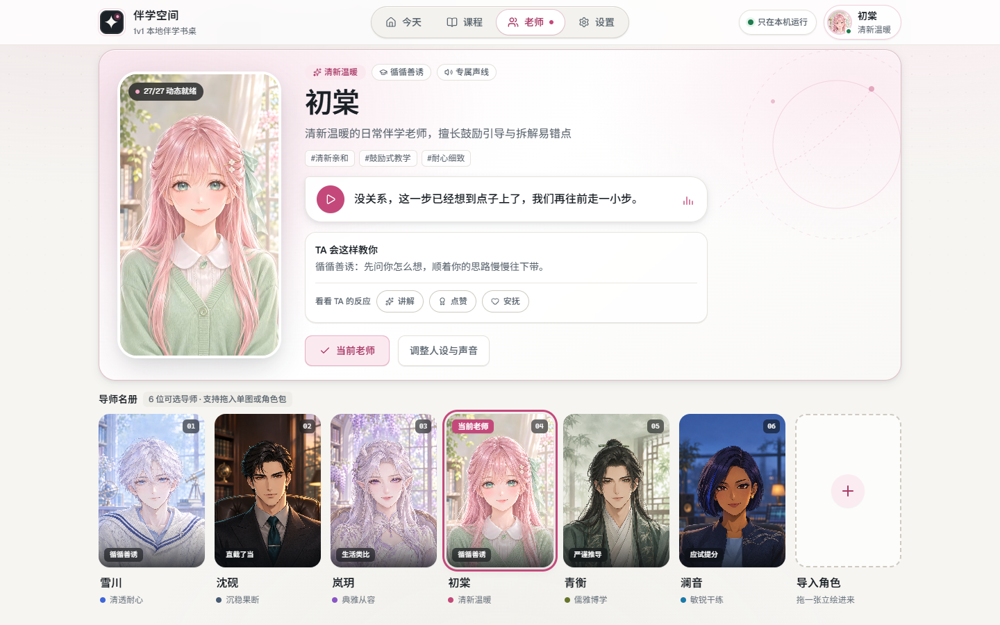
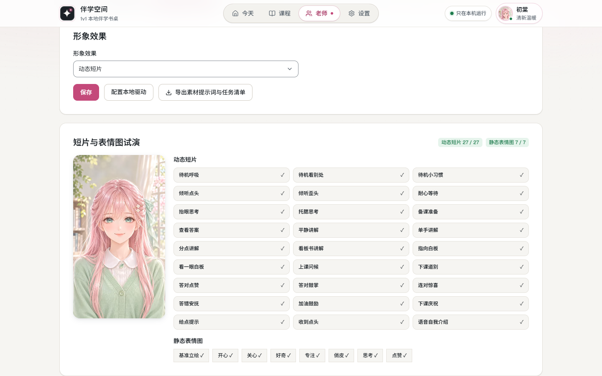
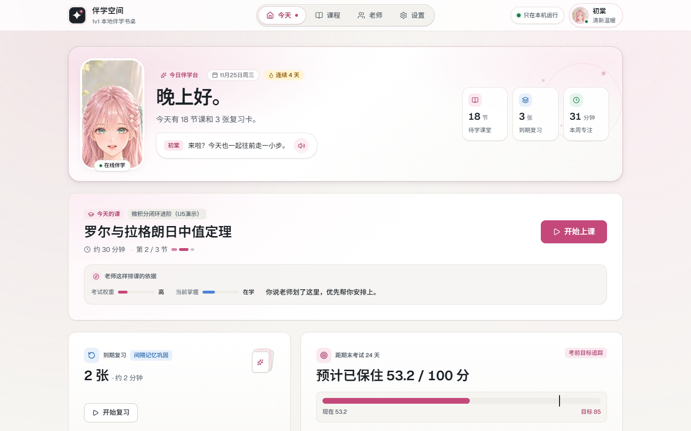
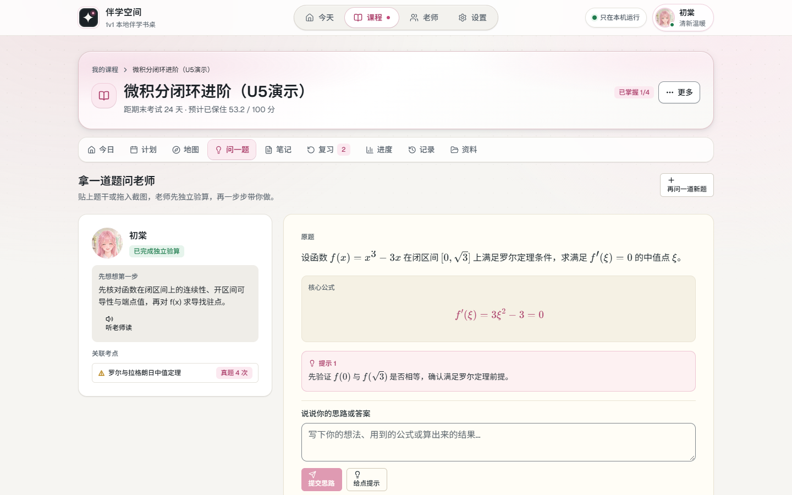
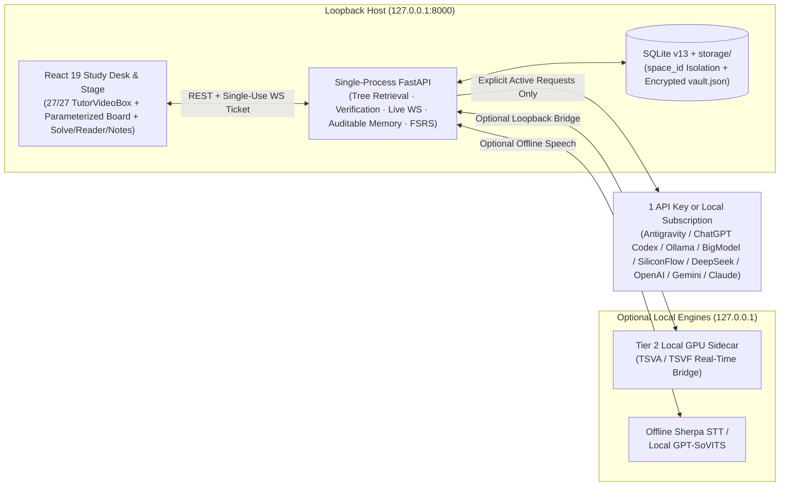

<div align="center">

# Companion Space

**Just One API Key — or Your Local Subscription (Antigravity / ChatGPT Codex / Ollama) — Ready Out of the Box**

A local-first, video-call style anime AI 1-on-1 tutor. Drop in your textbooks, slides, notes, and past exams to get a **source-linked course map, 6 built-in anime tutors with full 27/27 pure-video motion packs, an interactive parameterized blackboard, a dual-loop Solve Studio, an immersive Material Reader, block-based Notes, auditable learning memory, and FSRS spaced review** right on your own computer.

[简体中文](README.md) · [English](README.en.md) · [One Key or Local Sub](#one-api-key--or-local-subscription--ready-out-of-the-box) · [Study Studio (Phases 1–4)](#advanced-study-studio-deeptutor-inspired--phases-14) · [Interface Tour](#interface-tour-desktop--mobile) · [Quick Start](#quick-start) · [Changelog](CHANGELOG.md) · [Privacy & Data](docs/privacy-and-data.md) · [Asset Licenses](assets/avatars/LICENSES.md) · [Contributing](CONTRIBUTING.md)

[](https://github.com/Johnson-Durui/Companion-Space/actions/workflows/ci.yml)
[](https://github.com/Johnson-Durui/Companion-Space/releases)
[](#one-api-key--or-local-subscription--ready-out-of-the-box)
[](#six-built-in-anime-tutors-full-2727-h3-motion-animated-out-of-the-box)
[](LICENSE)
[](#privacy-security--guardrails)

</div>

<p align="center">
   6 tutors with 27/27 H3 motion -> Zero-scroll classroom with interactive parameterized math plots -> Solve Studio, Material Reader, Block Notes & Auditable Memory" width="960" />
</p>
<p align="center">
  🎬 <strong>Watch the Full HD Demo Video (MP4)</strong>:
  <a href="https://github.com/Johnson-Durui/Companion-Space/releases/download/v1.0.0/Companion-Space-v1.0.0-demo.mp4"><strong>Companion-Space-v1.0.0-demo.mp4</strong></a>
</p>
<p align="center">
  <sub>Launch and click <b>Sample Lesson (No Setup Required)</b> to try a 30-second animated lesson with zero keys — or connect a local subscription or a single API key to study from your own textbooks and exams.</sub>
</p>

---

## One API Key — or Local Subscription — Ready Out of the Box

No juggling separate keys for chat, analysis, verification, vision, speech, and avatars. One connection powers the entire study loop:

| Setup Path | All You Need | What Works Immediately |
| :--- | :--- | :--- |
| **Path A · Local Subscription (0 API Keys)** | An existing local **Antigravity subscription** (`agy acp`), **ChatGPT / Codex subscription** (`codex app-server`), or local **Ollama / LM Studio** | **Zero extra API keys, zero base-URL setup** — reuse your existing local login or local server for live tutoring, textbook analysis, independent verification, and photo vision. |
| **Path B · One API Key Does It All** | Just **1** LLM API key (built-in presets with a one-click free-tier filter & 3-step key guides for **BigModel GLM, SiliconFlow, DeepSeek, Alibaba DashScope, Volcano Ark, Kimi, OpenRouter, Google Gemini, OpenAI, and Anthropic Claude**) | One key automatically drives live teaching, course analysis, independent answer checking, and image recognition — plus **6 distinct built-in free Edge neural voices, so no second speech model or TTS key is needed**. |
| **Path C · 30-Second Zero-Config Trial** | Nothing at all — just launch the app | Click **Sample Lesson (No Setup Required)** right from the welcome screen to experience the animated tutor, synchronized math board, option-specific feedback, and recap immediately. |

> **Optional speech input without friction**: Listening to tutors and typing work with zero extra setup. When you want voice answers, either reuse SiliconFlow's free transcription endpoint (`SenseVoiceSmall`) or enable local offline **Sherpa-ONNX (SenseVoice)** — raw microphone audio stays strictly in memory.

---

## From Raw Materials to Mastery in Four Steps

Most AI study apps are just scrolling chat windows, while browser-based 3D VRM renderers burn laptop GPUs and still look stiff. **Companion Space** pairs a calm daytime **Study Desk** with an obsidian **1-on-1 Video-Call Classroom**:

| Stage | What You Do | What Companion Space Does |
| :--- | :--- | :--- |
| **1. Grounded Course Setup** | Drop in PDFs, PPTX, DOCX, images, or Markdown (textbooks + past exams) | A 5-step setup wizard extracts chapters & concepts with **exact page citations**, computes exam frequency & score weights, runs a quick 6-topic learner interview + placement check, and builds an **explainable study plan**. |
| **2. Warmup & Video Connect** | Click **Start Lesson** from Today (optionally flip through ≤ 5 due warmup flashcards) | Enters a zero-scroll classroom stage (`<StageShell>`) with a vertical **9:16 27/27 pure-video tutor** (`<TutorVideoBox>`) using 180 ms dual-`<video>` crossfades and zero WebGL GPU overhead. |
| **3. Live Synchronized Blackboard** | Listen, interrupt anytime via push-to-talk / hands-free VAD, drag plot sliders, or click any derivation line | KaTeX formulas, progressive line-by-line steps, 3-style emphasis marks, **declarative interactive parameterized function plots**, and Mermaid diagrams appear in sync with speech — complete with *"lost from this line"* re-explanation, board pagination, one-click Save to Notes, and an in-memory transcript drawer (`Shift+T`). |
| **4. Spaced Retention & Memory** | Complete inline checks, daily reviews, timed practice, and Solve Studio questions | Triggers **150 ms micro-reactions** (praise / clap / comfort) on grading, summarizes pre→post mastery gains on recap, schedules **FSRS review cards** & mistake drills, and updates **auditable learning memories** alongside your **projected score** grid. |

---

## Advanced Study Studio (DeepTutor-Inspired · Phases 1–4)

Inspired by the strongest ideas in [HKUDS/DeepTutor](https://github.com/HKUDS/DeepTutor) (Apache-2.0) while preserving Companion Space's single-process FastAPI + SQLite architecture, strict `space_id` isolation, and zero external graph databases:

- **Structured Tree Retrieval & Interactive Parameterized Blackboard (Phase 1)**:
  - Retrieves full source pages (with section titles & original page images) across 1-hop prerequisite/dependent `kp_edges`, `material_sections` trees, and full-text indices, falling back to cached TOC routing strictly validated against the active course.
  - Declarative `plot` blocks support up to **4 bounded numeric parameter sliders and 8 preset keyframes**, safely evaluated via a `mathjs/number` AST whitelist (zero `eval`). Live lessons synchronize parameters in real time via `<board_param>` tags while letting learners explore sliders and keyframes freely.
- **Dual-Loop "Ask a Question" Solve Studio (Phase 2)**:
  - Paste text/LaTeX questions or upload problem screenshots (≤ 8 MB JPG/PNG/WebP with vision transcription), automatically linked to course knowledge points, mastery, and recurring mistakes.
  - **Verify First, Coach Second**: Runs independent two-pass `ItemVerifier` checking before step-by-step coaching; solutions stay sealed until revealed, and disputed/unverified problems are labeled honestly with auto-grading disabled.
  - **Step Drilldown & Isomorphic Exam Mimics**: Click *"lost at this step"* on any revealed derivation line to expand 2–4 finer sub-steps, then generate **independently verified** exam-style variant questions modeled on non-reserved past exams (applying honest BKT evidence discounting after solution peeks and routing misses straight into FSRS review).
- **"What Your Tutor Remembers" — Auditable 3-Layer Learning Memory (Phase 3)**:
  - Captures lightweight structured learning traces from lesson recaps, Solve Studio, and Material Reader (never persisting raw audio or chat dumps), distilling course habits, explanation preferences, and a cross-course profile.
  - **Every memory links back to verifiable evidence** (lesson replay, solve session, or answer record; ungrounded or cross-course references are discarded). Learners retain full sovereignty in Course Progress and **Settings → Me** — **pin, edit, or forget** any item permanently so dismissed facts never enter future teaching or planning prompts.
- **Immersive Material Reader & Block-Based Course Notes (Phase 4)**:
  - **Material Reader**: Toggle between original page images and extracted text with inline KP mastery & past-exam frequency badges, highlight-to-ask tutoring, read-aloud speech, one-click capture to notes, and non-spoiler verified quick quizzes.
  - **Course Block Notes**: Reuses all 11 blackboard block types (including interactive parameterized plots, math, derivations, diagrams, and callouts) with one-click **Save to Notes** from Classroom, Reader, and Solve Studio. Includes strictly **read-only Diff suggestions** (*"Ask tutor to fill pitfalls"* — never mutating notes until you click Accept), one-click **FSRS flashcard conversion**, and **Markdown (`.md`) / Anki TSV (`.tsv`)** export with page citations.

---

## Why It's Not Another Chat Wrapper

- **Anti-Hallucination Teaching Engine**:
  - **Independent Pre-Class & Solve Verification**: Extracted exam answers, generated check items, and Solve Studio mimics must pass independent verification before entering the gradable item bank.
  - **No Unverified Improvised Questions**: Live lessons draw checks strictly from verified lesson plans. Objective items (single-choice, multi-choice, numeric) are graded deterministically in backend code; open responses follow explicit rubrics.
  - **Evidence-Only Mastery**: Mastery updates strictly from genuine answer evidence — peeking at answers or exhausting multi-level hints never inflates mastery and schedules a variant follow-up instead. Enforced in CI via `scripts/check_no_fakes.py`.
- **Zero-Scroll Desktop + Dual-Mode Mobile Video Call**:
  - Desktop live phases fit inside a zero-scroll viewport (`1280×585` up to wide 3-column layouts) with **Split / Board-First (draggable 9:16 PiP)** switching and full keyboard shortcuts (`?`).
  - Mobile (`< 768 px`) switches seamlessly between a WeChat-call style **Tutor Mode** and a full **Board Mode** with a floating 9:16 tutor window.
- **100% Local-First Ownership**:
  - Single-process loopback server (`127.0.0.1:8000`) backed by local SQLite, local file storage, and an encrypted server-side credential vault (`vault.json`). Raw microphone PCM16 audio and live classroom transcripts **stay strictly in memory and never touch disk or logs**.

---

## Six Built-In Anime Tutors (Full 27/27 H3 Motion, Animated Out of the Box)

All six original built-in tutors now ship with complete **27/27 full-phase motion packs (162 newly curated `576×1024 @ 24fps` single-keyframe VP9 `.webm` clips totaling 73.72 MB — every pack strictly ≤ 14 MB, every clip ≤ 0.93 MB — plus 42 registered 1080×1920 expression stills, 7/7 per tutor)**:
- **Full classroom phase coverage**: idle rotation (breathe / glance / fidget), lesson prep (`prepare_notes`), greeting & farewell waves, listening nod & tilt, patient waiting, reading answers, gaze & chin-rest thinking, hint cue (`hint_finger`), acknowledgement nod, 4-clip lecture rotation (calm / explain A / explain B / board talk), board glance & point, praise / clap / streak surprise, comfort & encouragement, lesson celebration, plus optional Opus mono `intro_voice` clips (disabled by default).
- **WCAG-verified accent palettes & 6 distinct free neural voices**: Switching tutors automatically updates desk and blackboard accents alongside 6 distinct built-in Edge Chinese neural voices (**zero extra TTS setup**), plus 6 normalized **24 kHz studio-dry reference WAVs** ([`assets/avatars/voices/`](assets/avatars/voices/voices_manifest.json)) for optional local GPT-SoVITS voice cloning.
- **Transparent AI provenance & split-pack licensing**: Anchor portraits and all 42 expression stills are AI-generated with **OpenAI Images 2.6** (Apache-2.0). All 162 motion clips (including 6 VP9+Opus `intro_voice` clips) and 6 voice reference WAVs are AI-generated locally with **MiniMax H3-Base (FL2VA)** and remain governed by the **MiniMax H3 Community License Agreement** (including EU/UK/KR/US territory restrictions and a prohibition on training other AI models; `allow_redistribution: false`). See [`assets/avatars/LICENSES.md`](assets/avatars/LICENSES.md) and [`assets/THIRD_PARTY_NOTICES.md`](assets/THIRD_PARTY_NOTICES.md). Portable builds support `-ExcludeVideoClips` to ship purely Apache-2.0 static portraits + 7 expression stills (200 ms switching), with optional local clip packs auto-discovered from `<data_dir>/avatar_packs/<tutor-id>/`.

<p align="center">
  
</p>

| Tutor | Persona & Specialty | Default Style | Signature Line | Full Motion & Default Voice |
| :--- | :--- | :--- | :--- | :--- |
| **雪川 (Xuechuan)** | Clear, patient astronomy TA who maps abstract concepts like star charts | Guided | *"Take your time — let's split this problem into a few anchor stars and connect them."* | 27/27 VP9 + 7 stills · `YunxiNeural` + 24 kHz WAV |
| **沈砚 (Shenyan)** | Decisive logic & strategy mentor focused on constraints and core conclusions | Direct | *"Check the boundary conditions first, then draw the conclusion straight to the core."* | 27/27 VP9 + 7 stills · `YunjianNeural` + 24 kHz WAV |
| **岚玥 (Lanyue)** | Graceful literature & imagery tutor who turns dense definitions into vivid mental pictures | Analogy | *"Place a tough definition inside a single image and you'll remember it at a glance."* | 27/27 VP9 + 7 stills · `XiaoyiNeural` + 24 kHz WAV |
| **初棠 (Chutang)** | Warm everyday study companion focused on encouragement and untangling tricky traps | Guided | *"No worries — you're already onto the key idea, let's take one small step forward."* | 27/27 VP9 + 7 stills · `XiaoxiaoNeural` + 24 kHz WAV |
| **青衡 (Qingheng)** | Erudite humanities & deduction scholar emphasizing causal chains and solid proof | Rigorous | *"Everything follows a causal thread; once the reasoning lines up, it clicks."* | 27/27 VP9 + 7 stills · `YunyangNeural` + 24 kHz WAV |
| **澜音 (Lanyin)** | Sharp acoustics & exam-prep coach targeting high-frequency test signals and scoring points | Exam Prep | *"Catch the signal words in the prompt — that's right where points are won or lost."* | 27/27 VP9 + 7 stills · `HsiaoChenNeural` + 24 kHz WAV |

---

## Interface Tour (Desktop & Mobile)

<table>
  <tr>
    <td width="50%">
      
      <p align="center"><sub><b>1. One API Key or Local Subscription Wizard</b> — Connect keyless Antigravity / ChatGPT Codex local subscriptions or any single API key (with free-tier filtering) in three guided steps</sub></p>
    </td>
    <td width="50%">
      
      <p align="center"><sub><b>2. 6 Built-In 27/27 Animated Tutors Gallery</b> — Full <code>27/27</code> motion readiness, distinct voices &amp; accent themes, single-image creation, and <code>.tutorpack</code> import</sub></p>
    </td>
  </tr>
  <tr>
    <td width="50%">
      
      <p align="center"><sub><b>3. 27/27 Motion Clips &amp; 7/7 Stills Audition</b> — Preview every single 576×1024 VP9 classroom clip and registered expression still directly inside the tutor studio</sub></p>
    </td>
    <td width="50%">
      
      <p align="center"><sub><b>4. Today Study Desk</b> — First-person tutor greeting, next lesson with plain-language scheduling rationale, due FSRS cards, projected score, and weekly streak</sub></p>
    </td>
  </tr>
  <tr>
    <td width="50%">
      
      <p align="center"><sub><b>5. Source-Linked Course Map</b> — Switch between chapter and exam-weight views with prerequisite chains, past-exam share, and exact textbook page citations</sub></p>
    </td>
    <td width="50%">
      
      <p align="center"><sub><b>6. Zero-Scroll Classroom &amp; Parameterized Board</b> — 9:16 pure-video tutor paired with progressive derivations, live slider/keyframe function plots (<code>&lt;board_param&gt;</code>), and verified checks</sub></p>
    </td>
  </tr>
  <tr>
    <td width="50%">
      
      <p align="center"><sub><b>7. Dual-Loop Solve Studio</b> — Text or photo question input, mandatory independent verification, step-by-step coaching, line drilldown, and verified past-exam mimic drills</sub></p>
    </td>
    <td width="50%">
      
      <p align="center"><sub><b>8. Course Block Notes &amp; Anki Export</b> — Reusable interactive board blocks, read-only Diff pitfall suggestions, one-click FSRS flashcards, and Markdown / Anki TSV export</sub></p>
    </td>
  </tr>
  <tr>
    <td width="50%">
      
      <p align="center"><sub><b>9. Immersive Material Reader &amp; Quick Quiz</b> — Page image/text toggle, KP mastery &amp; exam-frequency badges, highlight-to-ask explanations, read-aloud, and inline verified quizzes</sub></p>
    </td>
    <td width="50%">
      
      <p align="center"><sub><b>10. Progress Loop &amp; Auditable Memory</b> — Accessible hand-crafted SVG mastery charts paired with source-linked, editable, forgettable <i>What Your Tutor Remembers</i> cards</sub></p>
    </td>
  </tr>
  <tr>
    <td colspan="2">
      
      <p align="center"><sub><b>11. Mobile Dual-Mode Video Call (&lt; 768 px)</b> — Toggle effortlessly between vertical 9:16 Tutor Call Mode and full-screen Board Mode with a floating tutor PiP</sub></p>
    </td>
  </tr>
</table>

---

## Quick Start

### Option 1: Windows Portable ZIP (Recommended for Learners · Zero Dependencies)

No Python, Node.js, or terminal required:

1. Download `Companion-Space-1.0.0-windows-x64.zip` from [**GitHub Releases**](https://github.com/Johnson-Durui/Companion-Space/releases) (an accompanying `.sha256` checksum is provided; you can also build with `scripts/build-portable.ps1` or `-ExcludeVideoClips` for a purely Apache-2.0 static-portrait build).
2. Extract the folder anywhere and double-click **`start.bat`**. Your browser opens `http://127.0.0.1:8000/welcome`.
3. **Zero-Key 30-Second Trial**: Click **Sample Lesson (No Setup Required)** in the top-right corner to experience the animated tutor, synchronized math board, option-specific feedback, and recap right away.
4. **Connect in One Step**: Open the 3-step **Connect Wizard** in onboarding or **Settings → AI Services** — choose your existing **Antigravity / ChatGPT Codex local subscription** (0 API keys) or **Ollama / LM Studio**, or paste **1 API key** from any built-in preset (with one-click free-tier filtering), verify with **Test Chat**, and import your study files.

### Option 2: Run from Source (Developers / macOS / Linux)

Requires **Python 3.12+** and **Node.js 24+**. The launcher automatically sets up `.venv`, installs dependencies, and builds the web bundle on first run.

**Windows (PowerShell or double-click `start.bat`):**

```powershell
git clone https://github.com/Johnson-Durui/Companion-Space.git
cd Companion-Space

# Standard launch
powershell -NoProfile -ExecutionPolicy Bypass -File .\start.ps1

# Mainland China mirror (Tsinghua PyPI)
powershell -NoProfile -ExecutionPolicy Bypass -File .\start.ps1 -Mirror cn
```

**macOS / Linux:**

```bash
git clone https://github.com/Johnson-Durui/Companion-Space.git
cd Companion-Space
./start.sh
```

### Option 3: Single-Container Docker Compose

```bash
docker compose up --build -d
curl http://127.0.0.1:8000/healthz
```

Serves both the FastAPI backend and built web UI in one container, persists state in the `companion_data` volume, and binds strictly to loopback (`127.0.0.1:8000`).

### Optional Local Add-Ons

- **Offline Speech Recognition (Sherpa STT)**: All 6 distinct online Edge neural voices work out of the box; to enable offline in-memory speech recognition in a source install:
  ```bash
  .venv/bin/python -m pip install -r services/api/requirements-local-stt.txt   # .venv\Scripts\python.exe on Windows
  ```
- **Local Anime Voice Cloning (GPT-SoVITS)**: Point a tutor's voice setting at a local GPT-SoVITS server paired with the bundled 24 kHz dry reference WAVs under [`assets/avatars/voices/`](assets/avatars/voices/voices_manifest.json).
- **Build Custom 27-Slot `.tutorpack` Archives**: Use [`tools/tutorpack/`](tools/tutorpack/README.md) with automated 27-slot prompt generation, 14 MB tiered adaptive CRF ingest, 7-still registration, strict FFmpeg validation, and ComfyUI workflows:
  ```bash
  python tools/tutorpack/cli.py validate assets/avatars/packs/tutor-chutang --strict
  python tools/tutorpack/cli.py pack ./my-tutor-dir -o my-tutor.tutorpack
  ```

---

## Three-Tier Pure-Video Avatar Architecture

Scales smoothly from an everyday ultrabook to a local GPU desktop with **zero per-minute cloud avatar billing**:

| Tier | Mode | Experience & Best Use Case | Hardware & Cost |
| :--- | :--- | :--- | :--- |
| **Tier 0** | Single Portrait + 7 Expression Stills | Drop in any PNG / JPG / WebP to create a tutor immediately with breathing, voice-reactive halo & 200 ms expression still switching | Any browser · Free |
| **Tier 1 (Default)** | 27-Slot Motion Loop Pack (`.tutorpack`) | `576×1024 @ 24fps` single-keyframe VP9 + 2-stage idle prefetch + decoded first-frame 180 ms dual-`<video>` crossfade + 150 ms classroom micro-reactions | Any laptop · Zero per-minute cost |
| **Tier 2 (Optional)** | Local GPU Sidecar | Connect [`sidecars/local-gpu-avatar/`](sidecars/local-gpu-avatar/README.md) to local real-time lip-sync models (LivePortrait / Ditto / MuseTalk) | Your local GPU · Zero per-minute cost |

---

## Architecture & Project Layout



```text
Companion-Space/
├── apps/web/                  # React 19 + TypeScript + Tailwind v4 web app (Desk/Focus/Stage shells, Solve, Reader, Notes, Memory)
├── packages/
│   ├── avatar-engine/         # <TutorVideoBox> 27-slot choreographer, expression stills & single-video coordinator
│   ├── board/                 # Synchronized blackboard (KaTeX, progressive steps, parameterized interactive plots, Mermaid, notes reuse)
│   └── api-client/            # OpenAPI-generated typed client
├── services/api/              # FastAPI backend (local subscriptions & presets, tree retrieval, verification, live WS, solve, memory, notes, FSRS)
├── libs/
│   ├── prompts/v3/            # Prompts for teaching, analysis, verification, solve studio, memory distillation, reader & notes
│   └── schemas/               # Single-source tutor_media_catalog.json (27 active + 9 reserved clips & 7 stills)
├── assets/avatars/
│   ├── portraits/             # 6 original 9:16 anime anchor portraits (1080×1920 WebP)
│   ├── packs/                 # 6 full 27/27 576×1024 VP9 motion packs (162 .webm clips + 42 expression stills, each ≤ 14 MB)
│   └── voices/                # 6 normalized 24 kHz studio-dry voice-clone reference WAVs + manifest
├── content/                   # Built-in tutor personas & distinct voices, zero-key sample lesson replay & math speech map
├── tools/tutorpack/           # .tutorpack prompt gen / ingest / stills / strict validate / pack CLI & ComfyUI workflow
├── sidecars/local-gpu-avatar/ # Standalone Apache-2.0 local GPU real-time sidecar template & tests
├── docs/                      # Privacy, security model, pedagogical safety policy & showcase media
└── docker-compose.yml         # Single-container local Docker Compose
```

---

## Privacy, Security & Guardrails

- **Loopback by default**: Binds strictly to `127.0.0.1:8000` with owner session bearer tokens, Origin/CSRF checks, and single-use WebSocket tickets. Never expose it directly on `0.0.0.0` without an external authenticating HTTPS reverse proxy. See [Security Model](docs/security-model.md).
- **You own your study files**: Databases, uploaded materials, auditable learning memories, and encrypted `vault.json` credentials stay locally under `storage/` (configurable via `COMPANION_DATA_DIR`), with an optional master password lock under **Settings → Privacy & Data**. Raw microphone audio and live classroom transcripts never touch disk. See [Privacy & Data Handling](docs/privacy-and-data.md) and [Safety & Pedagogical Policy](docs/safety-policy.md).

---

## License & Acknowledgments

- All repository source code is licensed under **Apache-2.0**. Built-in tutor anchor portraits and 42 expression stills are AI-generated with **OpenAI Images 2.6** (Apache-2.0); all 162 motion clips (including 6 VP9+Opus `intro_voice` clips) and 6 24 kHz voice reference WAVs are AI-generated locally with **MiniMax H3-Base** and remain governed by the **MiniMax H3 Community License Agreement** (including EU/UK/KR/US territory restrictions and a prohibition on training other AI models; `allow_redistribution: false`). See [LICENSE](LICENSE), [NOTICE](NOTICE), [`assets/avatars/LICENSES.md`](assets/avatars/LICENSES.md), and [`assets/THIRD_PARTY_NOTICES.md`](assets/THIRD_PARTY_NOTICES.md).
- Architectural inspiration for the Phases 1–4 Study Studio owes thanks to [HKUDS/DeepTutor](https://github.com/HKUDS/DeepTutor) (Apache-2.0).
- Issues and pull requests are welcome — see [CONTRIBUTING.md](CONTRIBUTING.md) and [SECURITY.md](SECURITY.md) (never attach real API keys, `vault.json`, or private copyrighted textbooks to reports).
