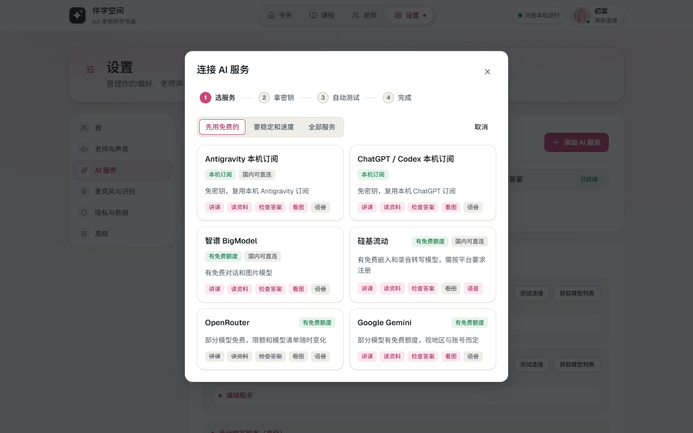
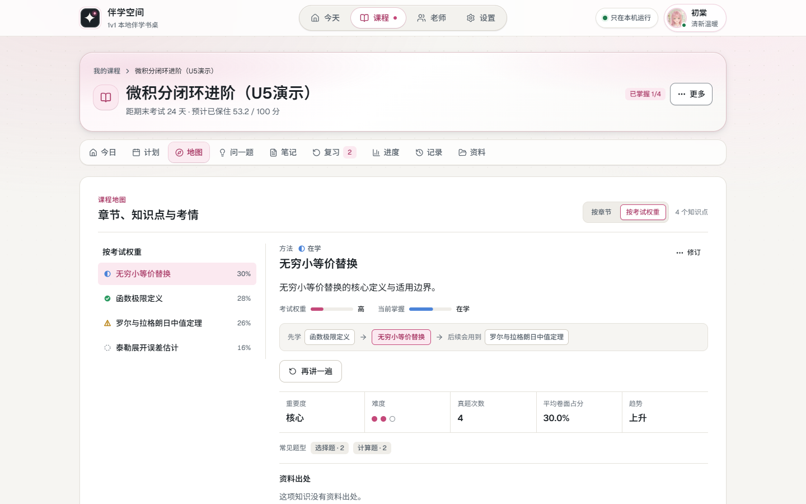
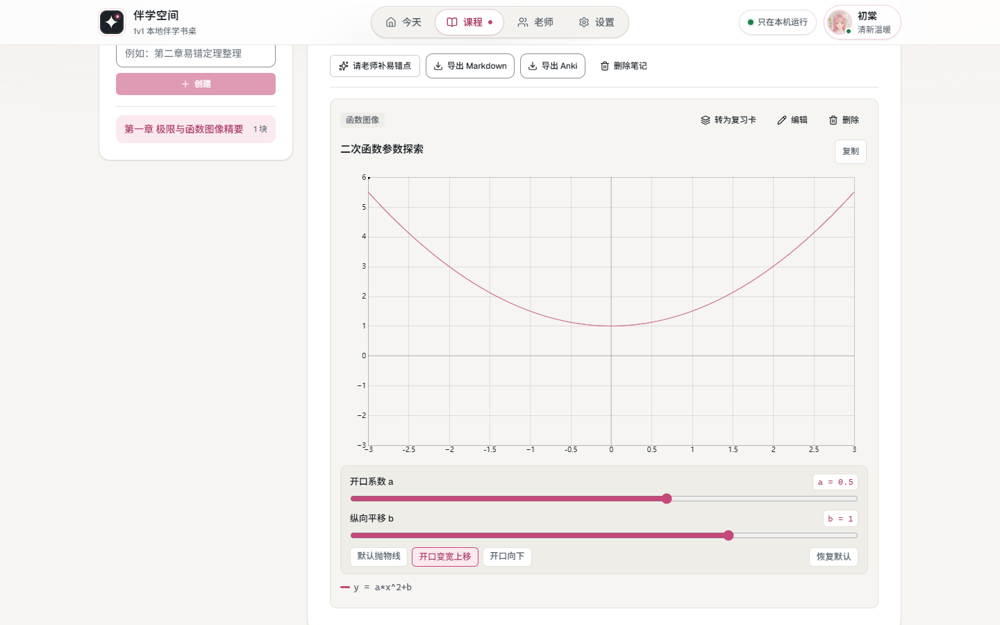
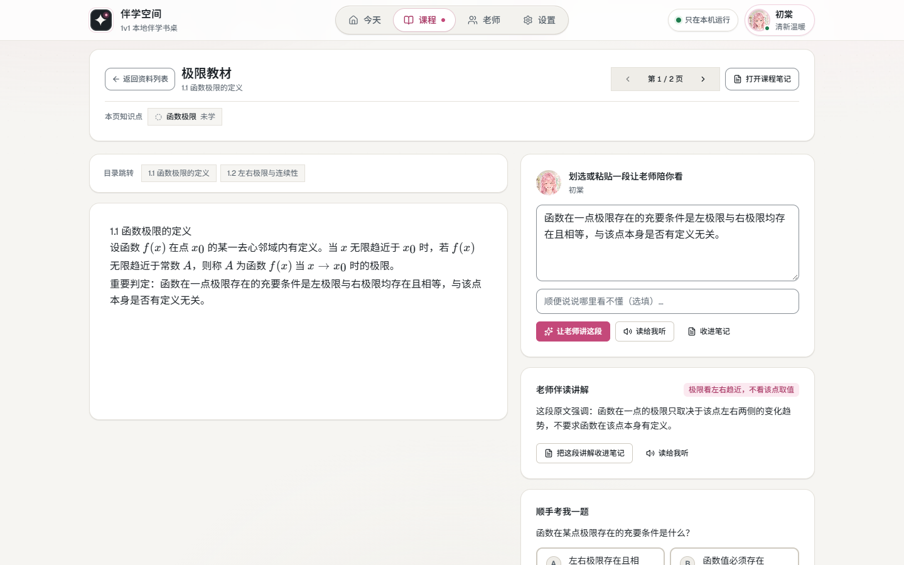
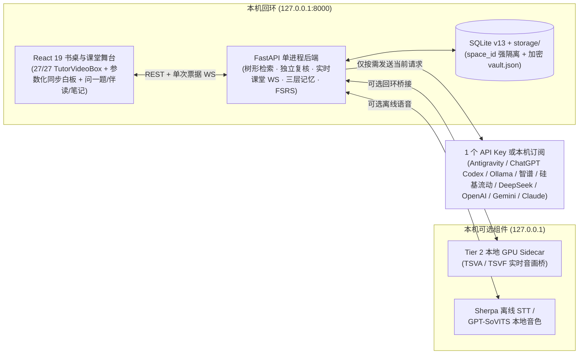

<div align="center">

# Companion Space · 伴学空间

**只需一个 API Key，或直接使用本机订阅（Antigravity / ChatGPT Codex / Ollama）一键全搞定**

像打视频电话一样的本地二次元 AI 1v1 专属导师 —— 放入你的教材、讲义、笔记和历年真题，在自己电脑上获得**可溯源考情课程地图、6 位 27/27 满配纯视频动态老师、参数化交互同步白板、「问一题」独立解题工坊、沉浸式教材伴读、积木笔记、可审计学习记忆与 FSRS 科学复习闭环**。

[简体中文](README.md) · [English](README.en.md) · [一个 Key 或本机订阅](#只需一个-api-key或本机订阅开箱即用) · [进阶工坊](#进阶学习工坊deeptutor-参考融合--phase-14) · [界面导览](#界面导览桌面与手机双端) · [快速开始](#快速开始) · [更新日志](CHANGELOG.md) · [安全与隐私](docs/privacy-and-data.md) · [素材授权](assets/avatars/LICENSES.md) · [参与贡献](CONTRIBUTING.md)

[](https://github.com/Johnson-Durui/Companion-Space/actions/workflows/ci.yml)
[](https://github.com/Johnson-Durui/Companion-Space/releases)
[](#只需一个-api-key或本机订阅开箱即用)
[](#六位内置二次元导师2727-满配动态开箱即动)
[](LICENSE)
[](#隐私安全与工程红线)

</div>

<p align="center">
  
</p>
<p align="center">
  🎬 <strong>观看完整高清实机演示视频（Full HD MP4）</strong>：
  <a href="https://github.com/Johnson-Durui/Companion-Space/releases/download/v1.0.0/Companion-Space-v1.0.0-demo.mp4"><strong>Companion-Space-v1.0.0-demo.mp4</strong></a>
</p>
<p align="center">
  <sub>打开即可免配置点<b>「先看一节示例课（不用配置）」</b>30 秒试听动态老师讲课与同步板书；连上本机订阅或 1 个 API Key 即可围绕你自己的教材与真题 1v1 开课。</sub>
</p>

---

## 只需一个 API Key，或本机订阅，开箱即用

不必折腾一堆模型、语音和数字人服务 —— **讲课、读教材、独立核题、拍题识图、6 位老师互异语音与 27/27 动态形象**，一条通道直接配齐：

| 接入方式 | 你只需要 | 立刻解锁的能力 |
| :--- | :--- | :--- |
| **方式 A · 本机订阅（0 API Key）** | 本机已登录的 **Antigravity 本机订阅**（`agy acp`）或 **ChatGPT / Codex 本机订阅**（`codex app-server`），或本机运行的 **Ollama / LM Studio** | **无需另买 API Key，免填地址**，直接复用本机已有订阅，一站覆盖实时讲课、教材拆解、独立复核与拍题识图。 |
| **方式 B · 一个 API Key 全包圆** | 填入 **1 个** 大模型 API Key（内置 **智谱 BigModel / 硅基流动 / DeepSeek / 阿里云百炼 / 火山方舟 / Kimi / OpenRouter / Google Gemini / OpenAI / Anthropic Claude** 预设，带「先用免费的」一键筛选与三步拿密钥指引） | 一个密钥自动同时承担实时讲课、教材拆解、独立复核与识图；**内置 6 位老师互异免费 Edge 神经声线，无需再配第二个声音模型或语音 Key**。 |
| **方式 C · 零配置 30 秒试听** | 什么都不用填，双击启动即可 | 欢迎页直接点 **「先看一节示例课（不用配置）」**，立刻体验动态老师讲课、同步公式板书、选项分支反馈与课后小结。 |

> **语音与高级扩展同样按需零负担**：听老师讲话与打字互动零额外配置；需要对着麦克风说话时，可直接复用硅基流动免费在线识别（`SenseVoiceSmall`）或一键启用本机离线 **Sherpa-ONNX（SenseVoice）**，原始语音始终仅驻留内存。

---

## 从资料到提分的四步闭环

大多数 AI 学习工具只是一个上下滚动的聊天框；而直接塞进浏览器的 3D VRM 渲染器又吃显卡、动作僵硬。**Companion Space** 把整个备考过程做成了一张安静的「个人书桌」与一间沉浸式「1v1 视频通话教室」：

| 阶段 | 你做什么 | Companion Space 帮你完成什么 |
| :--- | :--- | :--- |
| **1. 读懂资料与考情** | 拖入 PDF、PPTX、DOCX、图片或 Markdown（教材 + 历年真题） | 五步准备向导自动拆解章节考点、对齐**教材原页出处**、统计真题考频与分值权重，通过 6 维轻访谈与客观题摸底生成**带大白话排课理由**的专属学习计划。 |
| **2. 候课热身与接通** | 在「今天」点 **开始上课**（先刷最多 5 张到期闪卡热身） | 切入黑曜石专注课堂（`<StageShell>`），左侧 **9:16 竖屏 27/27 满配纯视频老师**（`<TutorVideoBox>`）双 `<video>` 180 ms 丝滑交叉切换动作，轻薄本零显卡负担。 |
| **3. 边讲边写，随时打断** | 听老师语音讲解，随时按住说话 / 免提插嘴，拖动函数图滑块，或点某一行推导追问 | KaTeX 公式、逐行分步推导、三态重点标记、**声明式参数化交互函数图**与 Mermaid 流程图随语音同步上板；支持行级 **「从这一行开始没跟上」**、清板分页回看、一键收进笔记与内存对话记录抽屉（`Shift+T`）。 |
| **4. 科学复习与长期记忆** | 完成随堂小题、每日到期复习卡、限时模考与课后「问一题」 | 判题后 **150 ms 内即时触发点赞 / 鼓掌 / 安抚微动作**；下课生成掌握度前后对比小结，自动排入 **FSRS 间隔记忆调度**、错题本与**可审计学习记忆**，实时追踪**预计已保住分值**与四态掌握度地图。 |

---

## 进阶学习工坊（DeepTutor 参考融合 · Phase 1–4）

借鉴 [HKUDS/DeepTutor](https://github.com/HKUDS/DeepTutor)（Apache-2.0）的长板设计，严守本仓单进程 FastAPI + SQLite、课程强隔离（`space_id`）与零外部图数据库约束，新增四套完整闭环能力：

- **结构化树形检索 + 参数化交互函数白板（Phase 1）**：
  - 沿知识点 1-hop 前置/后继依赖、教材章节树与全文索引整页回源（附章节名与原页图），跨章节自由追问时按需触发带缓存的目录路由并严格校验归属课程，避免断章取义与跨课幻觉。
  - 白板函数图支持**声明式数值参数（滑块）与预设关键帧**，基于 `mathjs/number` AST 白名单安全求值（零 `eval`）；实时课堂支持 `<board_param>` 随老师讲解同步调参，学生也可随时动手拖动滑块、切换关键帧或一键恢复默认。
- **「问一题」双循环独立解题工坊（Phase 2）**：
  - 支持直接贴入文字/公式题干或上传 8 MB 以内错题截图（JPG/PNG/WebP 识图），自动关联本课考点、当前掌握度与历史易错点。
  - **先独立验算，再分步引导**：强制调用 `ItemVerifier` 双轮验算并生成分步讲题蓝图，展开完整解法前绝不剧透答案；若验算存在分歧则诚实标注分歧、仅协同梳理思路且不写掌握度。
  - **行级拆步 + 真题同构仿写**：展开解法后可点任意一步 **「这一步没跟上」** 拆成 2–4 个更细小步；可仿照非模考保留真题生成**经独立复核**的同考点变式题巩固（看过原解法后按折减证据计入 BKT 掌握度，答错自动进入复习队列）。
- **「老师记住的你」可审计三层学习记忆（Phase 3）**：
  - 自动从课后小结、问一题与教材伴读中沉淀轻量结构化轨迹（绝不落盘原始音频与闲聊长日志），提炼课程易错习惯、讲法偏好与跨课程学习档案。
  - **每条记忆都可点击溯源**到具体课堂回放、问一题或作答记录（无实证或跨课引用自动丢弃）；你在课程进度页和「设置 → 我」里拥有完整主权 —— 随时**置顶、手动修订或一键「忘掉这条」**（忘掉后永久移出后续讲课与排课上下文）。
- **沉浸式教材伴读 + 课程积木笔记（Phase 4）**：
  - **教材伴读**：原页图 / 文字版随时对照，同页展示本页考点掌握度与真题考频徽标；支持划选任意段落向老师发问、语音朗读、一键收进笔记与不泄密的本页随堂小测（直接进入 BKT 与错题闭环）。
  - **课程积木笔记**：完整复用白板 11 类积木（含公式、推导步骤、参数化交互函数图、流程图、易错提示等），课堂白板、教材伴读与「问一题」均可一键 **「收进笔记」**；支持**严格只读不改库的「请老师补易错点」Diff 建议**（点「采纳插入」才写入）、任意积木一键转为 **FSRS 复习闪卡**，以及带原页引用的 **Markdown（`.md`）与 Anki TSV（`.tsv`）导出**。

---

## 为什么它不是另一个“套壳聊天框”？

- **防幻觉「真教学」内核**：
  - **课前与解题独立复核**：真题提取答案、备课检查题与「问一题」变式题均需通过独立求解复核，未核验题目绝不进入判分题库。
  - **课中不瞎编题**：实时课堂严格从已复核教案中抽题与推进要点，客观题（单选 / 多选 / 数值）由后端代码确定性判分，论述题按结构化采分点核对。
  - **诚实的掌握度计算**：「已掌握」只来自真实作答证据的概率更新；点击「看答案」或用完三级提示绝不虚增掌握度，系统会自动安排同类变式题再验一次。仓库门禁常驻 `scripts/check_no_fakes.py`，杜绝任何假数据或硬编码学科空壳。
- **桌面 + 手机双端零滚动课堂体验**：
  - 桌面端全相位一屏无页面滚动条（覆盖 `1280×585` 至宽屏三栏），支持 **「并排显示 / 白板优先（可拖拽 9:16 悬浮小窗）」** 与全键盘快捷键（`?`）。
  - 手机端（`< 768 px`）原生采用微信视频通话式 **「老师模式 / 白板模式」** 一键切换，底部控制坞避让安全区。
- **数据与密钥 100% 留在你本机**：
  - 单进程仅监听回环地址 `127.0.0.1:8000`，SQLite 数据库、上传教材与加密凭据保险箱（`vault.json`）均保存在本机；原始麦克风音频与课堂实时对话抽屉**仅驻留内存，绝不落盘或写入日志**。

---

## 六位内置二次元导师（27/27 满配动态，开箱即动）

仓库自带六位原创人设的二次元导师，全部完成 **27/27 全相位动态短片满配（6 位老师合计 162 段 `576×1024 @ 24fps` 单关键帧 VP9 `.webm` 短片，总计 73.72 MB，单包严格 ≤ 14 MB，单段 ≤ 0.93 MB；另含 42 张 1080×1920 静态表情图，全员 7/7）**：
- **覆盖完整课堂相位**：待机轮换（呼吸 / 看别处 / 小习惯）、备课（`prepare_notes`）、上课问候、下课道别、倾听点头 / 歪头、耐心等待、查看答案、抬眼 / 托腮思考、给点提示（`hint_finger`）、收到点头、多段讲解轮换（平静 / 单手 / 分点 / 看板书）、看白板 / 指白板、答对点赞 / 鼓掌 / 连对惊喜、答错安抚 / 加油鼓励、下课庆祝，以及预留的 Opus 单声道语音自我介绍（`intro_voice`，默认关闭）。
- **专属主题色 + 6 种互异免费神经声线**：切换老师即同步切换书桌与白板主题色（全通过 WCAG 对比度校验），内置 6 个两两互异的免费 Edge 中文神经声线，**无需额外配置语音模型或第二个 Key**；同时附带 6 条归一化 **24 kHz 棚录级干声参考 WAV**（[`assets/avatars/voices/`](assets/avatars/voices/voices_manifest.json)）供本机 GPT-SoVITS 等扩展使用。
- **真实诚实的 AI 生成来源与许可边界**：立绘与 42 张静态表情图由 **OpenAI Images 2.6** AI 生成（Apache-2.0）；162 段动态短片（含 6 段 VP9+Opus `intro_voice`）与 6 条干声参考由本机 **MiniMax H3-Base（FL2VA）** AI 生成，受 **MiniMax H3 Community License Agreement** 约束（含欧盟 / 英国 / 韩国 / 美国地域限制、禁止用于训练或微调其他 AI 模型、`allow_redistribution: false`）。完整明细见 [`assets/avatars/LICENSES.md`](assets/avatars/LICENSES.md) 与 [`assets/THIRD_PARTY_NOTICES.md`](assets/THIRD_PARTY_NOTICES.md)；便携打包支持 `-ExcludeVideoClips` 纯静态拆分打包，无短片时内置老师自动降级为静态立绘 + 7 张表情图 200 ms 切换，也可把自制或本地短片包放入 `<数据目录>/avatar_packs/<tutor-id>/` 自动发现。

<p align="center">
  
</p>

| 导师 | 风格定位 | 默认讲法 | 代表台词 | 满配动态与默认声线 |
| :--- | :--- | :--- | :--- | :--- |
| **雪川** | 清透耐心的天文助教，擅长把抽象概念画成星空坐标 | 循循善诱 | 「别急，我们把这道题拆成几颗坐标星慢慢连线。」 | 27/27 VP9 + 7 表情图 · `YunxiNeural` + 24 kHz 干声 |
| **沈砚** | 沉稳果断的策略与逻辑导师，直击核心结论与关键约束 | 直奔结论 | 「先看条件边界，再下结论，我们直奔核心。」 | 27/27 VP9 + 7 表情图 · `YunjianNeural` + 24 kHz 干声 |
| **岚玥** | 典雅从容的文学与意象导师，善用画面与类比化繁为简 | 画面类比 | 「把晦涩的定义放进一幅画面里，你一眼就能记住。」 | 27/27 VP9 + 7 表情图 · `XiaoyiNeural` + 24 kHz 干声 |
| **初棠** | 清新温暖的日常伴学老师，擅长鼓励引导与拆解易错点 | 循循善诱 | 「没关系，这一步已经想到点子上了，再往前走一小步。」 | 27/27 VP9 + 7 表情图 · `XiaoxiaoNeural` + 24 kHz 干声 |
| **青衡** | 儒雅博学的文史与推演导师，重视因果脉络与证据闭环 | 严谨推导 | 「凡事讲求因果脉络，把前后推演理顺便豁然开朗。」 | 27/27 VP9 + 7 表情图 · `YunyangNeural` + 24 kHz 干声 |
| **澜音** | 敏锐干练的声学与实战提分导师，专注高频考点与精准复盘 | 提分实战 | 「听清题干里的信号词，这里就是最容易丢分的节点。」 | 27/27 VP9 + 7 表情图 · `HsiaoChenNeural` + 24 kHz 干声 |

---

## 界面导览（桌面与手机双端）

<table>
  <tr>
    <td width="50%">
      
      <p align="center"><sub><b>1. 一个 API Key 或本机订阅连接向导</b> — 支持 Antigravity / ChatGPT Codex 免密钥本机订阅，或任选 1 个 API Key（带免费额度筛选）一键配齐全部能力</sub></p>
    </td>
    <td width="50%">
      
      <p align="center"><sub><b>2. 6 位 27/27 满配动态导师画廊</b> — 全员 <code>27/27 动态就绪</code>、专属全站主题色与互异神经声线，支持单图秒建或导入 <code>.tutorpack</code></sub></p>
    </td>
  </tr>
  <tr>
    <td width="50%">
      
      <p align="center"><sub><b>3. 27/27 动态短片与 7/7 表情图试演页</b> — 逐槽点击试播 27 段全相位 H3 动态短片与 7 张注册表情图，直观预览每种课堂状态</sub></p>
    </td>
    <td width="50%">
      
      <p align="center"><sub><b>4. 「今天」个人书桌</b> — 导师第一人称问候、今日课程与大白话排课依据、到期复习卡、预计已保住分值与本周学习打卡</sub></p>
    </td>
  </tr>
  <tr>
    <td width="50%">
      
      <p align="center"><sub><b>5. 可溯源考情课程地图</b> — 支持按章节 / 按考试权重切换，直观查看真题占比、前后置依赖链与教材原页出处</sub></p>
    </td>
    <td width="50%">
      
      <p align="center"><sub><b>6. 一屏零滚动课堂与参数化交互白板</b> — 左侧 9:16 动态导师语音讲解，右侧逐行公式推导与支持滑块/关键帧/<code>&lt;board_param&gt;</code> 联动的交互函数图</sub></p>
    </td>
  </tr>
  <tr>
    <td width="50%">
      
      <p align="center"><sub><b>7. 「问一题」双循环独立解题工坊</b> — 贴题干或传截图，先经独立验算再分步引导，支持行级「这一步没跟上」拆步与真题同构变式巩固</sub></p>
    </td>
    <td width="50%">
      
      <p align="center"><sub><b>8. 课程积木笔记与只读建议 / Anki 导出</b> — 复用白板积木一键收藏，支持只读 Diff 补易错点、一键转 FSRS 闪卡与 Markdown / Anki TSV 导出</sub></p>
    </td>
  </tr>
  <tr>
    <td width="50%">
      
      <p align="center"><sub><b>9. 沉浸式教材伴读与随堂小测</b> — 原页图与文字对照、考点考频徽标、划选原文即问老师、朗读收藏与不泄密随堂小测</sub></p>
    </td>
    <td width="50%">
      
      <p align="center"><sub><b>10. 学习闭环图表与「老师记住的你」</b> — 手写无障碍 SVG 图表叠加可点击溯源、可置顶/修订/忘掉的可审计学习记忆卡片</sub></p>
    </td>
  </tr>
  <tr>
    <td colspan="2">
      
      <p align="center"><sub><b>11. 手机端双模式视频通话课堂（&lt; 768 px）</b> — 默认微信通话式 9:16 竖屏导师 + 白板预览，点按一键展开完整推导白板并保留左上角悬浮导师小窗</sub></p>
    </td>
  </tr>
</table>

---

## 快速开始

### 方式一：下载 Windows 免安装便携包（推荐普通学生 · 零环境配置）

无需安装 Python、Node.js 或命令行工具：

1. 前往 [**GitHub Releases**](https://github.com/Johnson-Durui/Companion-Space/releases) 下载 `Companion-Space-1.0.0-windows-x64.zip`（可对照同名 `.sha256` 校验完整性；或自行通过 `scripts/build-portable.ps1` / `-ExcludeVideoClips` 构建含/不含 H3 短片的版本）。
2. 解压到任意文件夹，双击运行 **`start.bat`**，浏览器会自动打开 `http://127.0.0.1:8000/welcome`。
3. **30 秒免配置试听**：点击右上角 **「先看一节示例课（不用配置）」**，不用填任何密钥即可完整体验动态老师讲课、同步公式板书、选项分支反馈与课后小结。
4. **一键连上自己的模型**：在引导页或 **「设置 → AI 服务」** 打开三步连接向导 —— 直接选用已登录的 **Antigravity / ChatGPT Codex 本机订阅**（0 API Key）或 **Ollama / LM Studio**，或者任选一家服务商填入 **1 个 API Key**（带免费额度一键筛选），自动测试通过即可新建课程、拖入教材开课。

### 方式二：从源码一键启动（开发者 / macOS / Linux）

需安装 **Python 3.12+** 与 **Node.js 24+**。首次启动会自动创建 `.venv`、安装依赖并构建前端产物。

**Windows（PowerShell 或直接双击 `start.bat`）：**

```powershell
git clone https://github.com/Johnson-Durui/Companion-Space.git
cd Companion-Space

# 默认启动
powershell -NoProfile -ExecutionPolicy Bypass -File .\start.ps1

# 中国大陆网络可使用清华 PyPI 镜像加速依赖安装
powershell -NoProfile -ExecutionPolicy Bypass -File .\start.ps1 -Mirror cn
```

**macOS / Linux：**

```bash
git clone https://github.com/Johnson-Durui/Companion-Space.git
cd Companion-Space
./start.sh
```

### 方式三：Docker Compose 单容器部署

```bash
docker compose up --build -d
curl http://127.0.0.1:8000/healthz
```

单容器同时托管 FastAPI 后端与前端静态资源，学习数据持久化至命名卷 `companion_data`，端口默认仅绑定本机 `127.0.0.1:8000`。

### 可选本地增强

- **离线本地语音识别（Sherpa STT）**：默认免配置即可使用 6 位老师互异在线 Edge 神经语音朗读；如需纯本地内存离线语音转写，可在源码虚拟环境中安装：
  ```bash
  .venv/bin/python -m pip install -r services/api/requirements-local-stt.txt   # Windows 用 .venv\Scripts\python.exe
  ```
- **本地二次元声线克隆（GPT-SoVITS）**：本机启动 GPT-SoVITS 后，可在导师语音设置中填入本机地址并搭配 [`assets/avatars/voices/`](assets/avatars/voices/voices_manifest.json) 内置的 6 条 24 kHz 棚录干声。
- **自制 `.tutorpack` 27 槽动态角色包**：使用内置工具链 [`tools/tutorpack/`](tools/tutorpack/README.md)（支持 27 槽提示词生成、14 MB 分层自适应 CRF 入库、7 表情图配准、FFmpeg 严格校验与联系表导出）：
  ```bash
  python tools/tutorpack/cli.py validate assets/avatars/packs/tutor-chutang --strict
  python tools/tutorpack/cli.py pack ./my-tutor-dir -o my-tutor.tutorpack
  ```

---

## 三档纯视频形象架构

从日常轻薄本到带独显的工作站，均可按需无缝升降级，全程**零云端数字人按分钟计费**：

| 档位 | 驱动模式 | 体验与适用场景 | 算力要求与费用 |
| :--- | :--- | :--- | :--- |
| **Tier 0** | 单图立绘 + 7 表情图 | 拖入任意一张 PNG / JPG / WebP 立绘即可创建新老师（支持呼吸微动、说话光环与 200 ms 减动效表情图切换） | 任意浏览器 · 零费用 |
| **Tier 1（默认）** | 27 槽循环短片包（`.tutorpack`） | `576×1024 @ 24fps` 单关键帧 VP9 + 两级空闲预取 + 首帧解码后双 `<video>` 180 ms 交叉淡入淡出 + 150 ms 即时微动作 | 任意核显轻薄本 · 零费用 |
| **Tier 2（进阶）** | 本地 GPU 实时驱动（Sidecar） | 通过 [`sidecars/local-gpu-avatar/`](sidecars/local-gpu-avatar/README.md) 协议模板挂载本机 LivePortrait / Ditto / MuseTalk 等实时口型模型 | 本机独立显卡 · 零按分钟计费 |

---

## 系统架构与目录结构



```text
Companion-Space/
├── apps/web/                  # React 19 + TypeScript + Tailwind v4 前端（书桌/专注/舞台壳、问一题、伴读、积木笔记、记忆卡片）
├── packages/
│   ├── avatar-engine/         # <TutorVideoBox> 27 槽纯视频编排器、表情图切换与同屏单视频协调器
│   ├── board/                 # 同步教学白板（KaTeX、逐行推导、声明式参数化交互函数图、Mermaid、积木笔记复用）
│   └── api-client/            # 基于 OpenAPI 自动生成的类型安全接口客户端
├── services/api/              # FastAPI 单进程后端（本机订阅与多预设网关、资料树形检索、独立复核、实时课堂、问一题、记忆、伴读笔记、FSRS）
├── libs/
│   ├── prompts/v3/            # 教学、资料分析、解题复核、记忆提炼、伴读与笔记建议提示词模板
│   └── schemas/               # 单一数据源 tutor_media_catalog.json（27 槽短片 + 9 预留 + 7 表情图规范）
├── assets/avatars/
│   ├── portraits/             # 6 位原创 9:16 二次元导师锚点原画（1080×1920 WebP）
│   ├── packs/                 # 6 套 27/27 满配 576×1024 VP9 动态短片包（162 条 .webm + 42 张表情图，全包 ≤ 14 MB）
│   └── voices/                # 6 条归一化 24 kHz 棚录声音克隆参考干声 WAV + 清单
├── content/                   # 内置导师人设与互异声线配置、免密钥预生成示例课回放与数学口语读法表
├── tools/tutorpack/           # .tutorpack 提示词生成/入库/表情图配准/严格校验/打包 CLI 与 ComfyUI 模板
├── sidecars/local-gpu-avatar/ # 独立 Apache-2.0 本地 GPU 实时驱动参考服务端与协议测试
├── docs/                      # 隐私边界、安全模型、教学诚信红线与展示素材
└── docker-compose.yml         # 单容器本地部署编排
```

---

## 隐私安全与工程红线

- **默认仅绑定本机回环**：服务默认仅监听 `127.0.0.1:8000`，配套浏览器会话令牌、Origin/CSRF 校验与单次 WebSocket 票据；切勿直接改为 `0.0.0.0` 暴露在不受控网络中。详见 [安全模型](docs/security-model.md)。
- **数据完全可控**：课程 SQLite 库、上传讲义、学习记忆与加密凭据保存在 `storage/`（可通过 `COMPANION_DATA_DIR` 自定义），支持随时在「设置 → 隐私与数据」开启主密码锁定保险箱；原始语音与实时对话抽屉绝不落盘。详见 [隐私与数据处理](docs/privacy-and-data.md) 与 [教学与内容安全准则](docs/safety-policy.md)。

---

## 开源协议与致谢

- 本仓库全部源码以 **Apache-2.0** 协议开源；内置六位导师的立绘与 42 张静态表情图由 **OpenAI Images 2.6** AI 生成（Apache-2.0），162 段动态 VP9 短片（含 6 段 VP9+Opus `intro_voice`）与 6 条 24 kHz 干声参考由本机 **MiniMax H3-Base** AI 生成并受 **MiniMax H3 Community License Agreement**（含欧盟 / 英国 / 韩国 / 美国地域限制、禁止用于训练其他 AI 模型、`allow_redistribution: false`）约束，不按 Apache-2.0 再分发。完整声明见 [LICENSE](LICENSE)、[NOTICE](NOTICE)、[`assets/avatars/LICENSES.md`](assets/avatars/LICENSES.md) 与 [`assets/THIRD_PARTY_NOTICES.md`](assets/THIRD_PARTY_NOTICES.md)。
- 进阶学习工坊（Phase 1–4）部分架构思路参考自开源项目 [HKUDS/DeepTutor](https://github.com/HKUDS/DeepTutor)（Apache-2.0），特此致谢。
- 欢迎提交 [Issue](https://github.com/Johnson-Durui/Companion-Space/issues) 与 Pull Request（详见 [贡献指南](CONTRIBUTING.md)；反馈问题时请勿附带真实 API Key、`vault.json` 或受版权保护的私人教材）。
