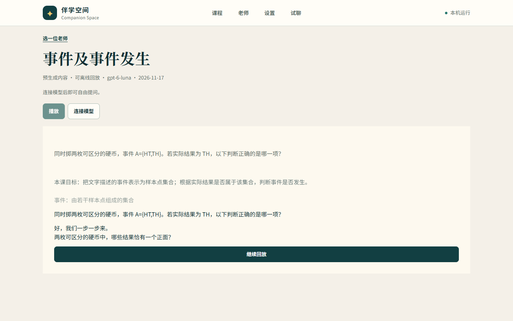

# Companion Space 1.0 RC

[English](README.en.md)

Companion Space 是本地优先、单用户的 AI 家教。你可以导入自己的教材、讲义、试卷和笔记，生成可核对来源的课程地图，完成学情访谈与摸底，再进入带语音、黑板和复习卡的实时课堂。

这是 `1.0.0-rc.1` 候选版本，不是已签名的正式发行版。应用数据默认只写入本机；使用外部模型时，完成当前操作所需的文本或图片会发送给你配置的服务商。

## 三条命令快速开始

需要 Windows 10/11、Python 3.12+ 和 Node.js 24。PowerShell 中运行：

```powershell
git clone https://github.com/Johnson-Durui/Companion-Space.git
cd Companion-Space
powershell -NoProfile -ExecutionPolicy Bypass -File .\start.ps1
```

浏览器会打开 `http://127.0.0.1:8000/welcome`。点「看示例课」即可在未配置 API Key 的情况下体验白板、作答、选项反馈和结课小结。示例课播放真实模型预先录制的内容。



要用自己的资料上课，请到「设置 → 模型」选择服务商、保存 API Key，并测试分析、对话、视觉和嵌入角色。可先用预设页的「关注免费额度」筛选服务，额度以服务商的说明为准。

## 当前能力

- 导入 PDF、PPTX、DOCX、图片、Markdown 和纯文本，并标记教材、讲义、试卷等资料角色。
- 用配置的真实模型生成课程地图、知识点、题目关联和答案复核状态；所有自动结果都可人工修正。
- 学情访谈、摸底、学习计划、实时语音/文字课堂、黑板同步、打断与断线恢复。
- 课堂后的 FSRS 复习卡与错题复盘。
- 微信视频通话风格的竖屏纯视频框老师（`<TutorVideoBox>`）：默认内置六位 2D 角色（其中 `tutor-echo` 沐音与 `tutor-nova` 星澜的 Apache-2.0 立绘可用于便携和容器包），支持在角色库拖入单张图片秒建老师或导入 `.tutorpack` 8 段循环短片包；旧版 3D VRM 已退场归档至 `assets-archive/retired-vrm/`。
- 内置二次元 `.tutorpack` 制作脚手架（`tools/tutorpack/`）与完全独立的本地 GPU 实时驱动参考模板（`sidecars/local-gpu-avatar/`），可在「设置 → 视频形象」按需接入本地显卡开源驱动，默认零按分钟计费。
- Edge 在线语音为零配置默认。可选本地 Sherpa STT 需在源码环境单独安装，模型权重不会随发行包分发。

## Windows 便携包

维护者可构建内置 CPython 3.14.10 x64 的目录式压缩包：

```powershell
powershell -NoProfile -ExecutionPolicy Bypass -File .\scripts\build-portable.ps1
powershell -NoProfile -ExecutionPolicy Bypass -File .\scripts\smoke-portable.ps1
```

压缩包和 SHA-256 文件输出到 `outputs/`。用户解压后双击 `start.bat`；数据写入解压目录的 `data/`。程序目前未做代码签名，Windows SmartScreen 可能显示“未知发布者”；只使用项目发布页提供且 SHA-256 匹配的包，选择“更多信息 → 仍要运行”。不要从来源不明的镜像下载。

四张历史立绘的再分发许可尚待所有者核验，因此构建脚本会把它们和对应角色目录项排除，并在包内写入 `PORTABLE-ASSET-STATUS.md`。这不影响源码本机运行，但在许可完成前不得公开发布包含这些文件的二进制包。

## Docker（可选）

Docker Compose 只启动一个同时托管 API 与界面的服务：

```bash
docker compose up --build -d
docker compose ps
curl http://127.0.0.1:8000/healthz
```

数据保存在 `companion_data` 卷。端口只绑定回环地址；不要把它改成 `0.0.0.0` 直接暴露到局域网或公网。设置页可启用主密码来保护模型凭据，但它不是反向代理的网络访问口令。需要远程访问时，必须在前面配置带 HTTPS 和身份验证的反向代理，本项目的 Compose 文件不会替你开放远程入口。

## 可选本地语音识别

源码环境可安装 Sherpa 扩展：

```powershell
.\.venv\Scripts\python.exe -m pip install -r services/api/requirements-local-stt.txt
```

首次选择本地识别时按界面提示取得模型并确认其许可证。Sherpa 运行时和语音模型均不打入便携包；音频只在内存中处理，不写入磁盘。

## 数据、迁移与备份

- 源码启动默认使用 `storage/`；便携包使用自身的 `data/`；Docker 使用命名卷。可用 `COMPANION_DATA_DIR` 指定一个独立目录。
- 从旧版本升级前先完整备份旧数据目录和 `vault.json`。RC 不会主动删除或搬移旧目录，也不要把不同安装同时指向同一数据目录。
- 旧版手机壳、成人模式、第三方 Live2D/Spine bridge、角色捏人和旧多容器 Caddy 部署已下线。载入旧数据库后，可到「课程记录」把对话导出为 Markdown。保留原安装与备份，先在副本验证迁移。
- 主密码保险箱由应用在首次打开时按现有格式迁移；看到迁移或解锁错误时停止写入，恢复备份后再处理，不要删除 `vault.json` 猜测修复。

## 限制与发布状态

- 课程分析和实时教学的模型质量、真人麦克风与耳机延迟、干净 Windows 新用户流程仍需验收。实时资料分析和实时课堂需要配置模型。
- 便携包未签名；Docker 镜像当前不发布到公共仓库。
- MIRA、KITE、CAEL、LYRA 四张立绘的公开再分发许可仍待核验。

许可详情见 [LICENSE](LICENSE)、[NOTICE](NOTICE) 和 [第三方素材清单](assets/THIRD_PARTY_NOTICES.md)。问题报告请附启动方式、系统版本、失败页面和去敏后的日志，绝不要提交 API Key、`vault.json` 或个人教材。
