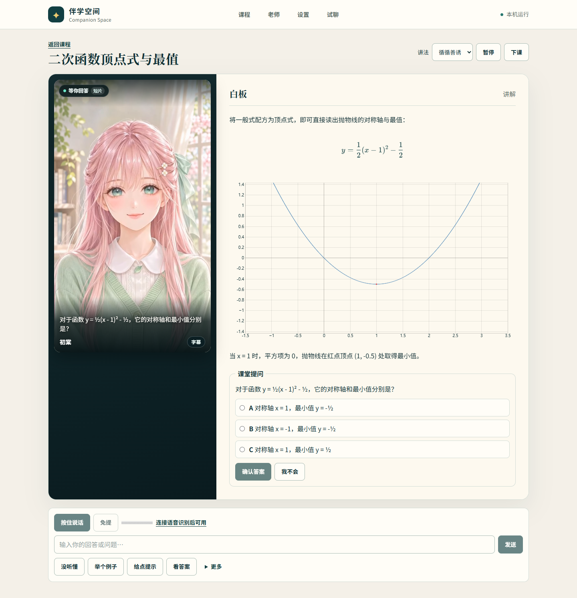
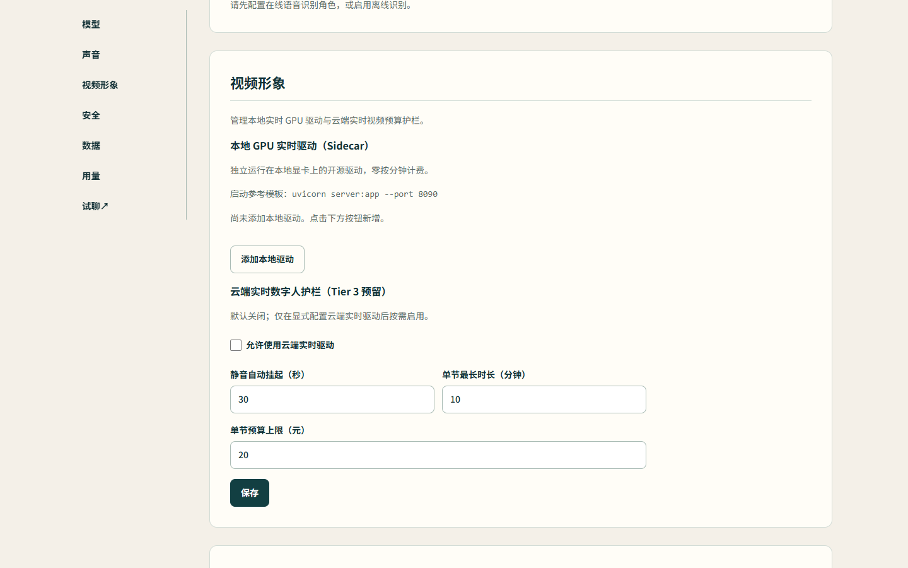

<div align="center">

# Companion Space · 伴学空间

**像打视频电话一样的本地二次元 AI 1v1 导师**

导入你的教材、讲义、笔记和真题，让原创动态二次元老师对着同步白板 1 对 1 讲课、随时打断追问、课后用 FSRS 帮着复习。

[简体中文](README.md) · [English](README.en.md) · [更新日志](CHANGELOG.md) · [素材授权](assets/avatars/LICENSES.md)

[](https://github.com/Johnson-Durui/Companion-Space/actions/workflows/ci.yml)
[](https://github.com/Johnson-Durui/Companion-Space/releases)
[](LICENSE)
[](#本地优先与隐私边界)

</div>

<p align="center">
  
</p>

---

## 为什么做这个项目

大多数 AI 学习工具只是一个反复滚动的聊天框；而直接塞进浏览器的 3D VRM 渲染器又吃显卡、画风容易僵硬。

**Companion Space** 走了一条更轻、更像真人私教的路：

- **视频通话式课堂体验**：把老师放进微信视频通话比例的 **9:16 竖屏纯视频窗**（`<TutorVideoBox>`），双 `<video>` 180 ms 无缝切换动作，判题答对/答错 150 ms 内立刻给微表情反馈，彻底告别 3D WebGL 负担。
- **真正围绕你的资料上课**：直接丢入 PDF、PPTX、DOCX、图片、Markdown 或纯文本，按教材 / 讲义 / 真题整理成**可溯源、可手动校对**的课程地图，再根据学情访谈与摸底安排学习计划。
- **边讲边写黑板，随时插嘴打断**：公式（KaTeX）、函数图像、表格、流程图与语音同步上板；听不懂直接打断追问、换讲法或要求举例子，课后自动沉淀为 **FSRS 复习卡** 与错题回顾。
- **数据留在自己电脑上**：单进程本地运行，默认仅监听 `127.0.0.1`，不强绑云端账号，模型与语音服务由你自己掌控。

---

## 六位内置二次元老师（开箱即动）

仓库自带六位原创二次元导师，全部以 **Apache-2.0** 开源分发。每一位都已装好 **8/8 完整静音 VP9 动作循环短片包**（待机呼吸、倾听点头、托腮思考、讲解 A/B、指向白板、答对点赞、答错安抚），同时附带降噪归一化的 **24 kHz 棚录声音克隆干声 WAV**（[`assets/avatars/voices/`](assets/avatars/voices/voices_manifest.json)），方便直接接入本地或自定义音色克隆。

<p align="center">
  
</p>

| 老师 | 风格定位 | 默认讲法 | 代表台词 | 内置资产 |
| :--- | :--- | :--- | :--- | :--- |
| **雪川** | 清透耐心的天文助教，擅长把抽象概念连成坐标星图 | 循循善诱 | 「别急，我们把这道题拆成几颗坐标星慢慢连线。」 | 8/8 VP9 动效 + 24 kHz 干声 |
| **沈砚** | 沉稳果断的策略与逻辑导师，直击核心结论与边界条件 | 直奔结论 | 「先看条件边界，再下结论，我们直奔核心。」 | 8/8 VP9 动效 + 24 kHz 干声 |
| **岚玥** | 典雅从容的文学与意象导师，善用画面与类比化繁为简 | 画面类比 | 「把晦涩的定义放进一幅画面里，你一眼就能记住。」 | 8/8 VP9 动效 + 24 kHz 干声 |
| **初棠** | 清新温暖的日常伴学老师，擅长鼓励引导与拆解易错点 | 循循善诱 | 「没关系，这一步已经想到点子上了，我们再往前走一小步。」 | 8/8 VP9 动效 + 24 kHz 干声 |
| **青衡** | 儒雅博学的文史与推演导师，重视因果脉络与证据闭环 | 严谨推导 | 「凡事讲求因果脉络，我们把前后推演理顺便豁然开朗。」 | 8/8 VP9 动效 + 24 kHz 干声 |
| **澜音** | 敏锐干练的声学与实战提分导师，专注高频考点与精准复盘 | 提分实战 | 「听清题干里的信号词，这里就是最容易丢分的节点。」 | 8/8 VP9 动效 + 24 kHz 干声 |

---

## 界面展示

<table>
  <tr>
    <td width="50%">
      
      <p align="center"><sub><b>1. 欢迎页与选老师</b> — 一键切换六位内置动态导师、试听声线，无需 API Key 即可直接点「看一节示例课」</sub></p>
    </td>
    <td width="50%">
      
      <p align="center"><sub><b>2. 角色库与动效包管理</b> — 实时查看 8/8 动作槽位、试演 7 种教学表情、拖入单张图秒建老师或导入 <code>.tutorpack</code></sub></p>
    </td>
  </tr>
  <tr>
    <td colspan="2">
      
      <p align="center"><sub><b>3. 视频形象与本地 GPU 驱动设置</b> — 支持按需接入本地显卡 Sidecar 实时驱动，并为预留云端实时能力提供时长与预算上限护栏</sub></p>
    </td>
  </tr>
</table>

---

## 三档纯视频形象架构

无论你手里是轻薄办公本，还是带独立显卡的工作站，都可以按需切换：

| 档位 | 模式 | 适用场景 | 算力与费用 |
| :--- | :--- | :--- | :--- |
| **Tier 0** | 单图秒建静态立绘 | 拖入任意一张 PNG / JPG / WebP 立刻建好新老师 | 零显卡需求 · 零费用 |
| **Tier 1（默认）** | 8 槽位循环短片包（`.tutorpack`） | 双 `<video>` 180 ms 交叉淡入淡出 + 150 ms 教学即时动作反应 | 普通浏览器流畅运行 · 零按分钟计费 |
| **Tier 2（进阶）** | 本地 GPU 实时驱动（Sidecar） | 接入 `sidecars/local-gpu-avatar/` 协议模板（适配 LivePortrait / Ditto / MuseTalk 等开源项目） | 使用本机显卡 · 零按分钟计费 |

### 制作你自己的 `.tutorpack` 老师

仓库内置独立工具链 [`tools/tutorpack/`](tools/tutorpack/README.md)，包含六位角色的 8 段视频提示词模板、ComfyUI 首尾帧工作流与校验打包 CLI：

```bash
# 校验角色目录的 8 槽位短片与清单
python tools/tutorpack/cli.py validate assets/avatars/packs/tutor-chutang

# 打包为可分享的 .tutorpack（导入角色库即用）
python tools/tutorpack/cli.py pack ./my-tutor-dir -o my-tutor.tutorpack
```

---

## 快速开始

### 方式一：源码一键启动（推荐）

需要 **Python 3.12+** 与 **Node.js 24+**。

**Windows（PowerShell 或双击 `start.bat`）：**

```powershell
git clone https://github.com/Johnson-Durui/Companion-Space.git
cd Companion-Space
powershell -NoProfile -ExecutionPolicy Bypass -File .\start.ps1
```

**macOS / Linux：**

```bash
git clone https://github.com/Johnson-Durui/Companion-Space.git
cd Companion-Space
./start.sh
```

启动后浏览器会自动打开 `http://127.0.0.1:8000/welcome`：

1. **零配置体验**：直接点 **「看一节示例课」**，不用填 API Key 就能体验白板讲解、随堂作答、选项反馈与结课小结。
2. **用自己的资料上课**：打开 **「设置 → 模型」** 配置任意 OpenAI 兼容或主流大模型服务商的 API Key（内置支持筛选含免费额度的预设服务商），测试通过后即可导入 PDF / PPTX / DOCX / 图片 / Markdown 开始学习。

### 方式二：Docker Compose 单容器部署

```bash
docker compose up --build -d
curl http://127.0.0.1:8000/healthz
```

单容器同时托管 FastAPI 后端与编译好的前端界面，数据持久化到命名卷 `companion_data`，端口默认仅绑定 `127.0.0.1`。

### 可选扩展

- **本地离线语音识别（Sherpa STT）**：默认使用免配置的 Edge 在线语音朗读；如需本地离线转写，可在虚拟环境中额外安装：
  ```bash
  pip install -r services/api/requirements-local-stt.txt
  ```
- **Windows 便携包构建**：维护者可在 Python 3.14 x64 环境下运行 `.\scripts\build-portable.ps1` 与 `.\scripts\smoke-portable.ps1`，生成带嵌入式 Python 与 SHA-256 校验文件的目录式 ZIP（输出至 `outputs/`）。

---

## 本地优先与隐私边界

- **默认只跑在本机回环**：服务默认监听 `127.0.0.1:8000`，请勿直接改成 `0.0.0.0` 裸奔暴露到公网；若确有远程访问需求，请在前端自行架设带 HTTPS 与独立鉴权的反向代理。
- **凭据与数据归属**：课程数据库、上传讲义与设置均保存在本机（源码运行在 `storage/`，可通过 `COMPANION_DATA_DIR` 指定独立路径）；主密码保险箱用于保护本机保存的 API Key。
- **外部请求透明**：仅在触发真实模型分析、对话、视觉识别或在线语音时，将当前请求必需的文本或图片发送给你自己配置的服务商。

---

## 项目结构

```text
Companion-Space/
├── apps/web/                 # React 19 + TypeScript + Vite 前端界面
├── packages/
│   ├── avatar-engine/        # <TutorVideoBox> 纯视频编排器与状态机
│   ├── board/                # 同步黑板（KaTeX 公式、函数绘图、Mermaid、表格）
│   └── api-client/           # 基于 OpenAPI 自动生成的类型安全客户端
├── services/api/             # FastAPI 后端（课程分析、实时教学 WS、FSRS、角色与语音）
├── assets/avatars/
│   ├── portraits/            # 6 位原创 9:16 锚点图（WebP）
│   ├── packs/                # 6 套完整 8/8 静音 VP9 循环短片包（共 48 条 .webm）
│   └── voices/               # 6 条 24 kHz 棚录声音克隆干声参考 WAV + 清单
├── tools/tutorpack/          # .tutorpack 校验/打包 CLI、提示词与 ComfyUI 模板
├── sidecars/local-gpu-avatar/# 独立 Apache-2.0 本地 GPU 实时驱动参考服务端
├── infra/docker/             # 单服务 Dockerfile 与冒烟配置
└── docker-compose.yml        # 单容器本地部署编排
```

---

## 开源协议与素材说明

- 本项目代码与六位内置二次元导师原画、48 条循环短片、6 条干声参考音均采用 **Apache-2.0** 协议开源，完整署名与登记见 [LICENSE](LICENSE)、[NOTICE](NOTICE)、[`assets/avatars/LICENSES.md`](assets/avatars/LICENSES.md) 与 [`assets/THIRD_PARTY_NOTICES.md`](assets/THIRD_PARTY_NOTICES.md)。
- 欢迎提 Issue 或 PR（提交反馈时请勿附带真实 API Key、`vault.json` 或隐私教材）。
