<div align="center">

# Companion Space · 伴学空间

**像打视频电话一样的本地二次元 AI 1v1 专属导师**

放入你的教材、讲义、笔记和历年真题 —— 在自己电脑上获得**可溯源考情课程地图、9:16 纯视频动态老师、逐行同步白板与 FSRS 科学复习闭环**。

[简体中文](README.md) · [English](README.en.md) · [快速开始](#快速开始) · [更新日志](CHANGELOG.md) · [安全与隐私](docs/privacy-and-data.md) · [素材授权](assets/avatars/LICENSES.md) · [参与贡献](CONTRIBUTING.md)

[](https://github.com/Johnson-Durui/Companion-Space/actions/workflows/ci.yml)
[](https://github.com/Johnson-Durui/Companion-Space/releases)
[](LICENSE)
[](#隐私安全与工程红线)
[](#三档纯视频形象架构)

</div>

<p align="center">
  
</p>
<p align="center">
  <sub>无需配置密钥即可点<b>「先看一节示例课」</b>直接体验动态老师讲课、同步板书与随堂互动；接上模型即可围绕你自己的教材与真题开课。</sub>
</p>

---

## 从资料到提分的四步闭环

大多数 AI 学习工具只是一个上下滚动的聊天框；而直接塞进浏览器的 3D VRM 渲染器又吃显卡、动作僵硬。**Companion Space** 把整个备考过程做成了一张安静的「个人书桌」与一间沉浸式「1v1 视频通话教室」：

| 阶段 | 你做什么 | Companion Space 帮你完成什么 |
| :--- | :--- | :--- |
| **1. 读懂资料与考情** | 拖入 PDF、PPTX、DOCX、图片或 Markdown（教材 + 历年真题） | 五步准备向导自动拆解章节考点、对齐**教材原页出处**、统计真题考频与分值权重，通过 6 维轻访谈与客观题摸底生成**带大白话排课理由**的专属学习计划。 |
| **2. 候课热身与接通** | 在「今天」点 **开始上课**（先刷最多 5 张到期闪卡热身） | 切入黑曜石专注课堂（`<StageShell>`），左侧 **9:16 竖屏纯视频老师**（`<TutorVideoBox>`）双 `<video>` 180 ms 丝滑交叉切换动作，普通轻薄本零显卡负担。 |
| **3. 边讲边写，随时打断** | 听老师语音讲解，随时按住说话 / 免提插嘴，或点某一行推导追问 | KaTeX 公式、逐行分步推导、三态重点标记、带图例与坐标标注的 SVG 函数图、Mermaid 流程图随语音同步上板；支持行级 **「从这一行开始没跟上」**、清板分页回看与内存对话记录抽屉（`Shift+T`）。 |
| **4. 科学复习与保分追踪** | 完成随堂小题、每日到期复习卡与限时模拟小测 | 判题后 **150 ms 内即时触发点赞 / 安抚微表情**；下课生成掌握度前后对比小结，自动排入 **FSRS 间隔记忆调度**与错题本，实时可视化**预计已保住分值**与四态掌握度地图。 |

---

## 为什么它不是另一个“套壳聊天框”？

- **防幻觉「真教学」内核**：
  - **课前独立复核**：真题提取答案与备课生成的检查题均需通过独立求解复核，未核验题目绝不进入判分题库。
  - **课中不瞎编题**：实时课堂严格从已复核教案中抽题与推进要点，客观题（单选 / 多选 / 数值）由后端代码确定性判分，论述题按结构化采分点核对。
  - **诚实的掌握度计算**：「已掌握」只来自真实作答证据的概率更新；点击「看答案」或用完三级提示绝不虚增掌握度，系统会自动安排同类变式题再验一次。仓库门禁常驻 `scripts/check_no_fakes.py`，杜绝任何假数据或硬编码学科空壳。
- **桌面 + 手机双端零滚动课堂体验**：
  - 桌面端全相位一屏无页面滚动条（覆盖 `1280×585` 至宽屏三栏），支持 **「并排显示 / 白板优先（可拖拽 9:16 悬浮小窗）」** 与全键盘快捷键（`?`）。
  - 手机端（`< 768 px`）原生采用微信视频通话式 **「老师模式 / 白板模式」** 一键切换，底部控制坞避让安全区。
- **数据与密钥 100% 留在你本机**：
  - 单进程仅监听回环地址 `127.0.0.1:8000`，SQLite 数据库、上传教材与加密凭据保险箱（`vault.json`）均保存在本机；原始麦克风音频与课堂实时对话抽屉**仅驻留内存，绝不落盘或写入日志**。

---

## 六位内置二次元导师（AI 生成素材，开箱即动）

仓库自带六位原创人设的二次元导师（**立绘与表情图由 OpenAI Images 2.6 生成，动态短片与干声参考由本机 MiniMax H3-Base 生成**；完整来源与地域限制见 [`assets/avatars/LICENSES.md`](assets/avatars/LICENSES.md) 与 [`assets/THIRD_PARTY_NOTICES.md`](assets/THIRD_PARTY_NOTICES.md)）。每位导师均配备：
- **专属全站主题色与独立中文神经声线**（切换老师即切换书桌与白板强调色，全通过 WCAG 对比度校验）；
- **扩展静音 VP9 动态短片包与 7 张静态表情图**（支持待机轮换、备课/问候/道别/倾听/等待/多段讲解与静态/减动效表情切换；亦可通过 `-ExcludeVideoClips` 拆分打包、按静态+表情图档运行）；
- **24 kHz 棚录级干声参考 WAV**（[`assets/avatars/voices/`](assets/avatars/voices/voices_manifest.json)，受 MiniMax H3 社区许可约束，不得用于训练或微调其他 AI 语音模型）。

<p align="center">
  
</p>

| 导师 | 风格定位 | 默认讲法 | 代表台词 | 内置开源资产 |
| :--- | :--- | :--- | :--- | :--- |
| **雪川** | 清透耐心的天文助教，擅长把抽象概念画成星空坐标 | 循循善诱 | 「别急，我们把这道题拆成几颗坐标星慢慢连线。」 | 8/8 VP9 动效 + 24 kHz 干声 |
| **沈砚** | 沉稳果断的策略与逻辑导师，直击核心结论与关键约束 | 直奔结论 | 「先看条件边界，再下结论，我们直奔核心。」 | 8/8 VP9 动效 + 24 kHz 干声 |
| **岚玥** | 典雅从容的文学与意象导师，善用画面与类比化繁为简 | 画面类比 | 「把晦涩的定义放进一幅画面里，你一眼就能记住。」 | 8/8 VP9 动效 + 24 kHz 干声 |
| **初棠** | 清新温暖的日常伴学老师，擅长鼓励引导与拆解易错点 | 循循善诱 | 「没关系，这一步已经想到点子上了，再往前走一小步。」 | 8/8 VP9 动效 + 24 kHz 干声 |
| **青衡** | 儒雅博学的文史与推演导师，重视因果脉络与证据闭环 | 严谨推导 | 「凡事讲求因果脉络，把前后推演理顺便豁然开朗。」 | 8/8 VP9 动效 + 24 kHz 干声 |
| **澜音** | 敏锐干练的声学与实战提分导师，专注高频考点与精准复盘 | 提分实战 | 「听清题干里的信号词，这里就是最容易丢分的节点。」 | 8/8 VP9 动效 + 24 kHz 干声 |

---

## 界面导览（桌面与手机双端）

<table>
  <tr>
    <td width="50%">
      
      <p align="center"><sub><b>1. 「今天」个人书桌</b> — 导师第一人称问候、今日课程与排课原因、到期复习卡、预计已保住分值与连续打卡一目了然</sub></p>
    </td>
    <td width="50%">
      
      <p align="center"><sub><b>2. 可溯源考情课程地图</b> — 支持按章节/按考试权重切换，直观查看真题占比、前后置依赖链与教材原页出处</sub></p>
    </td>
  </tr>
  <tr>
    <td width="50%">
      
      <p align="center"><sub><b>3. 一屏零滚动视频黑板课堂</b> — 左侧 9:16 动态导师语音讲解，右侧逐行公式推导、SVG 函数图像与底部随堂作答同步联动</sub></p>
    </td>
    <td width="50%">
      
      <p align="center"><sub><b>4. 学习进度与闭环图表</b> — 手写无障碍 SVG 图表呈现保分进度条、四态掌握度方格（点击可看逐次作答时间线）与学习日历</sub></p>
    </td>
  </tr>
  <tr>
    <td width="50%">
      
      <p align="center"><sub><b>5. 导师画廊与人设工坊</b> — 一键试演讲解/点赞/安抚动作，支持拖入单张图片秒建新老师或导入 <code>.tutorpack</code> 角色包</sub></p>
    </td>
    <td width="50%">
      
      <p align="center"><sub><b>6. 六分区设置与三步连接向导</b> — 清晰划分「我 / 老师与声音 / AI 服务 / 麦克风与识别 / 隐私与数据 / 高级」，对学生零技术黑话</sub></p>
    </td>
  </tr>
  <tr>
    <td colspan="2">
      
      <p align="center"><sub><b>7. 手机端双模式视频通话（&lt; 768 px）</b> — 默认微信通话式 9:16 竖屏导师 + 白板预览，点按一键展开完整推导白板并保留左上角悬浮导师小窗</sub></p>
    </td>
  </tr>
</table>

---

## 快速开始

### 方式一：下载 Windows 免安装便携包（推荐普通学生 · 零环境配置）

无需安装 Python、Node.js 或命令行工具：

1. 前往 [**GitHub Releases**](https://github.com/Johnson-Durui/Companion-Space/releases) 下载最新的 `Companion-Space-*-windows-x64.zip`（可对照同名 `.sha256` 文件校验完整性）。
2. 解压到任意文件夹，双击运行 **`start.bat`**，浏览器会自动打开 `http://127.0.0.1:8000/welcome`。
3. **30 秒免配置试听**：点击右上角 **「先看一节示例课（不用配置）」**，不用填任何密钥即可完整体验动态老师讲课、同步公式板书、选项分支反馈与课后小结。
4. **开始学自己的资料**：在引导页或 **「设置 → AI 服务」** 打开三步连接向导（内置智谱 GLM、硅基流动、DeepSeek、OpenAI、Gemini、Claude、Ollama / LM Studio 等预设，支持一键筛选**免费额度**服务商），测试连通后即可新建课程、拖入教材开课。

### 方式二：从源码一键启动（开发者 / macOS / Linux）

需安装 **Python 3.12+** 与 **Node.js 24+**。首次启动会自动创建 `.venv`、安装依赖并构建前端产物。

**Windows（PowerShell 或直接双击 `start.bat`）：**

```powershell
git clone https://github.com/Johnson-Durui/Companion-Space.git
cd Companion-Space

# 默认启动
powershell -NoProfile -ExecutionPolicy Bypass -File .\start.ps1

# 中国大陆网络可使用清华 PyPI 镜像加速依赖安装
powershell -NoProfile -ExecutionPolicy Bypass -File .\start.ps1 -Mirror cn
```

**macOS / Linux：**

```bash
git clone https://github.com/Johnson-Durui/Companion-Space.git
cd Companion-Space
./start.sh
```

### 方式三：Docker Compose 单容器部署

```bash
docker compose up --build -d
curl http://127.0.0.1:8000/healthz
```

单容器同时托管 FastAPI 后端与前端静态资源，学习数据持久化至命名卷 `companion_data`，端口默认仅绑定本机 `127.0.0.1:8000`。

### 可选本地增强

- **离线本地语音识别（Sherpa STT）**：默认免配置即可使用在线 Edge 语音朗读；如需纯本地内存离线语音转写，可在源码虚拟环境中安装：
  ```bash
  .venv/bin/python -m pip install -r services/api/requirements-local-stt.txt   # Windows 用 .venv\Scripts\python.exe
  ```
- **本地二次元声线克隆（GPT-SoVITS）**：本机启动 GPT-SoVITS 后，可在导师语音设置中直接填入本机地址并搭配 [`assets/avatars/voices/`](assets/avatars/voices/voices_manifest.json) 内置的 6 条 24 kHz 棚录干声。
- **自制 `.tutorpack` 动态角色包**：使用内置工具链 [`tools/tutorpack/`](tools/tutorpack/README.md)（附 6 位角色 8 段图生视频防穿模提示词与 ComfyUI 首尾帧锁定工作流）：
  ```bash
  python tools/tutorpack/cli.py validate assets/avatars/packs/tutor-chutang
  python tools/tutorpack/cli.py pack ./my-tutor-dir -o my-tutor.tutorpack
  ```

---

## 三档纯视频形象架构

从日常轻薄本到带独显的工作站，均可按需无缝升降级，全程**零云端数字人按分钟计费**：

| 档位 | 驱动模式 | 体验与适用场景 | 算力要求与费用 |
| :--- | :--- | :--- | :--- |
| **Tier 0** | 单图秒建静态导师 | 拖入任意一张 PNG / JPG / WebP 立绘即可创建新老师（含呼吸微动与说话声波光环） | 任意浏览器 · 零费用 |
| **Tier 1（默认）** | 8 槽位循环短片包（`.tutorpack`） | 空闲预取 + 首帧解码后双 `<video>` 180 ms 交叉淡入淡出 + 150 ms 判题即时微表情 | 任意核显轻薄本 · 零费用 |
| **Tier 2（进阶）** | 本地 GPU 实时驱动（Sidecar） | 通过 [`sidecars/local-gpu-avatar/`](sidecars/local-gpu-avatar/README.md) 协议模板挂载本机 LivePortrait / Ditto / MuseTalk 等实时口型模型 | 本机独立显卡 · 零按分钟计费 |

---

## 系统架构与目录结构

```mermaid
flowchart LR
  subgraph Local["本机回环 (127.0.0.1:8000)"]
    UI["React 19 书桌与课堂舞台\n(TutorVideoBox + 同步白板 + SVG 图表)"]
    API["FastAPI 单进程后端\n(资料解析 · 备课复核 · 实时教学 WS · FSRS)"]
    DB[("SQLite + storage/\n(按 space_id 课程隔离 + 加密 vault.json)")]
    UI <-->|"REST + 单次票据 WS"| API
    API <--> DB
  end

  subgraph OptionalLocal["本机可选组件 (127.0.0.1)"]
    Sidecar["Tier 2 本地 GPU Sidecar\n(TSVA / TSVF 实时音画桥)"]
    VoiceLocal["Sherpa 离线 STT /\nGPT-SoVITS 本地音色"]
  end

  Providers["用户自选模型与在线语音服务\n(智谱 / DeepSeek / 硅基流动 / OpenAI / Gemini / Claude / Ollama)"]

  API <-->|"可选回环桥接"| Sidecar
  API <-->|"可选离线语音"| VoiceLocal
  API -->|"仅按需发送当前请求"| Providers
```



```text
Companion-Space/
├── apps/web/                  # React 19 + TypeScript + Tailwind v4 前端（书桌壳、专注壳、一屏课堂舞台）
├── packages/
│   ├── avatar-engine/         # <TutorVideoBox> 纯视频编排器、相位状态映射与单视频协调器
│   ├── board/                 # 同步教学白板（KaTeX 公式、逐行推导、SVG 函数绘图、Mermaid、表格）
│   └── api-client/            # 基于 OpenAPI 自动生成的类型安全接口客户端
├── services/api/              # FastAPI 单进程后端（资料分析、教案独立复核、实时课堂、FSRS、保险箱）
├── assets/avatars/
│   ├── portraits/             # 6 位原创 9:16 二次元导师锚点原画（WebP）
│   ├── packs/                 # 6 套完整 8/8 静音 VP9 循环动作短片包（共 48 条 .webm）
│   └── voices/                # 6 条归一化 24 kHz 棚录声音克隆参考干声 WAV + 清单
├── content/                   # 内置导师人设配置、免密钥预生成示例课回放与数学口语读法表
├── tools/tutorpack/           # .tutorpack 脚手架/校验/打包 CLI、角色专属提示词与 ComfyUI 模板
├── sidecars/local-gpu-avatar/ # 独立 Apache-2.0 本地 GPU 实时驱动参考服务端与协议测试
├── docs/                      # 隐私边界、安全模型、教学诚信红线与素材许可说明
└── docker-compose.yml         # 单容器本地部署编排
```

---

## 隐私安全与工程红线

- **默认仅绑定本机回环**：服务默认仅监听 `127.0.0.1:8000`，配套浏览器会话令牌、Origin/CSRF 校验与单次 WebSocket 票据；切勿直接改为 `0.0.0.0` 暴露在不受控网络中。详见 [安全模型](docs/security-model.md)。
- **数据完全可控**：课程 SQLite 库、上传讲义与设置保存在 `storage/`（可通过 `COMPANION_DATA_DIR` 自定义），支持随时在「设置 → 隐私与数据」开启主密码锁定保险箱；原始语音与实时对话抽屉绝不落盘。详见 [隐私与数据处理](docs/privacy-and-data.md) 与 [教学与内容安全准则](docs/safety-policy.md)。

---

## 开源协议与致谢

- 本仓库全部源码以 **Apache-2.0** 协议开源；内置六位导师的立绘与静态表情图由 **OpenAI Images 2.6** AI 生成（Apache-2.0），动态 VP9 短片与 24 kHz 干声参考由本机 **MiniMax H3-Base** AI 生成并受 **MiniMax H3 Community License Agreement**（含欧盟/英国/韩国/美国地域限制、禁止用于训练其他 AI 模型）约束，不按 Apache-2.0 再分发。完整声明见 [LICENSE](LICENSE)、[NOTICE](NOTICE)、[`assets/avatars/LICENSES.md`](assets/avatars/LICENSES.md) 与 [`assets/THIRD_PARTY_NOTICES.md`](assets/THIRD_PARTY_NOTICES.md)。
- 欢迎提交 [Issue](https://github.com/Johnson-Durui/Companion-Space/issues) 与 Pull Request（详见 [贡献指南](CONTRIBUTING.md)；反馈问题时请勿附带真实 API Key、`vault.json` 或受版权保护的私人教材）。
