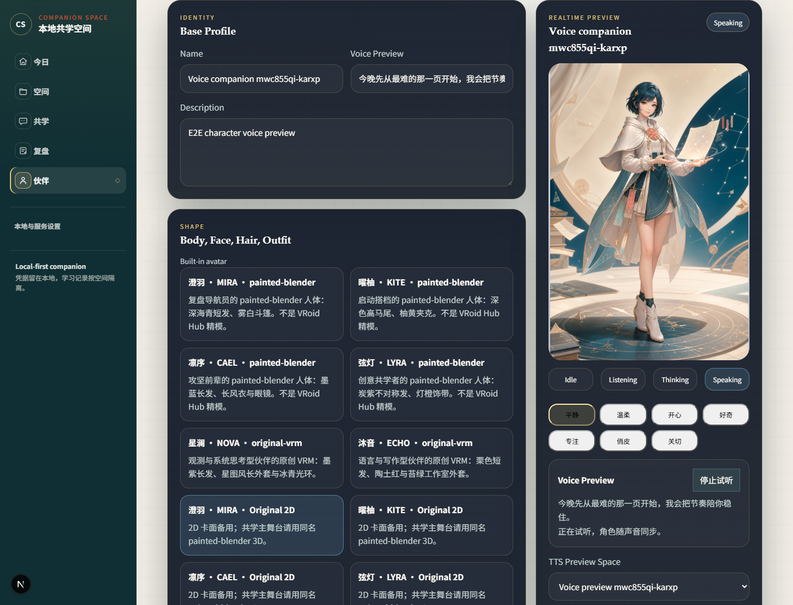
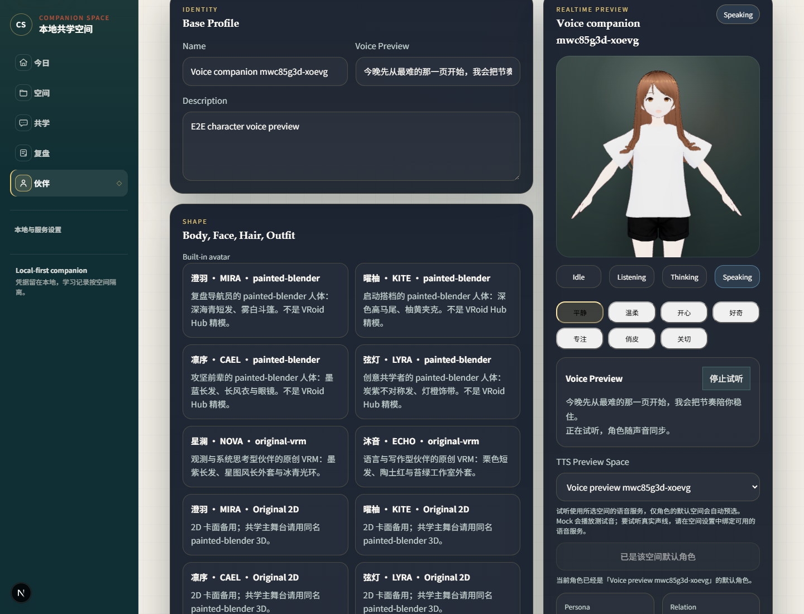

# 角色试听更新 · 2026-11-11

本轮按用户确认的角色声音调研、数字人架构方案和 Eciyuan 交互方案，补齐了角色工作室中声音与形象预览的联动。设计依据及逐项核对见 [角色、模型与语音设计续作](../design/character-voice-continuation-20261111.md)。

## 使用

1. 打开「伙伴」，进入一个已有角色的编辑页。
2. 选择「TTS Preview Space」中的学习空间，调整试听文字、声线与语速。
3. 点击「试听声音」：准备时角色进入思考状态，播放时进入说话状态；播放电平驱动现有口型或 2D 说话反馈。
4. 「停止试听」在准备和播放期间都可使用。试听结束、停止、换空间、修改角色配方或离开页面后，旧音频不会继续排队或在迟到返回时重新播放。

试听结束后恢复原先选择的手动预览状态，实际播放状态不会写回角色配方。错误会在编辑页显示，修正配置后可以重试。

试听使用所选空间绑定的语音服务。Mock 返回固定测试音，用来检查播放和动作联动；真实角色声线需要配置可用的本地神经语音或外部 TTS。此次自动化使用受控 PCM，不代表已完成神经模型实听、物理扬声器或 GPU 性能验收。

## 改动

- `apps/web/components/character-editor.tsx`：试听生命周期、请求身份校验、AbortSignal、队列排空/停止/卸载清理。
- `apps/web/components/character-workshop.tsx`：临时预览状态、停止控件、设置变更取消及准确的试听说明。未取得空间能力详情时不再误标为 TTS missing。
- `tests/e2e/character-voice-preview.spec.ts`：受控音频、迟到响应与真实浏览器播放回归。

复用现有 Web Audio、speech controller、VRM/2D 和 API，没有新增依赖、模型权重或接口，也没有改动已经通过验证的实时通话协议。

## 验证记录

本轮验收已完成：

| 检查 | 结果 |
| --- | --- |
| 新增角色试听浏览器回归 | 5/5 通过，41 秒；修改前先证实状态联动缺失 |
| 既有完整 Mock 主旅程 | 1/1 通过，约 1.8 分钟；包含角色编辑与学习闭环 |
| TypeScript | `npm run typecheck:web` 通过 |
| ESLint | `npm run lint:web` 通过，零告警 |
| 生产构建 | 将 `NEXT_DIST_DIR` 设为 `.next-local-production` 后，`npm run build:web` 通过 |
| 独立代码审查及 diff 检查 | 无阻断发现；`git diff --check` 通过 |

VRM 验证等待模型真正加载后才开始试听，播放时实际口型权重大于零，停止后回到零；2D 验证播放电平与结束后的复位。取消用例让旧请求在新音频已播放后才返回，并验证没有额外启动旧音频。测试使用独立数据，3100/8100 测试服务已退出。

机器可读汇总见 [本轮验证记录](evidence/character-voice-20261111.json)。上一轮的 API 548 项、移动构建、安全审计和独立安装验证仍记录于 [上一轮交付记录](delivery-20261111.md)，不重复标为本轮测试结果。

以下为测试数据下的真实浏览器截图，分别展示 2D 和已加载 VRM 的试听状态：

本轮源码与素材归档为 `Companion-Space-20261111-voice-preview.zip`，附逐文件 manifest 和 SHA-256，沿用 [Windows 启动说明](../../WINDOWS-README.md)。原 `Companion-Space-20261111.zip` 保留原样。依赖、启动器及服务端均未改动，本轮没有重新做全新机器安装；不要将上一轮独立安装的结论当作本包重新安装的证据。
